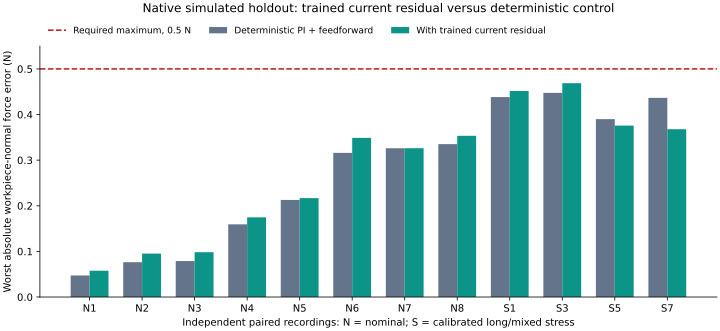
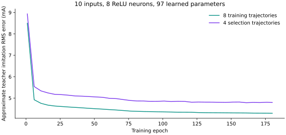
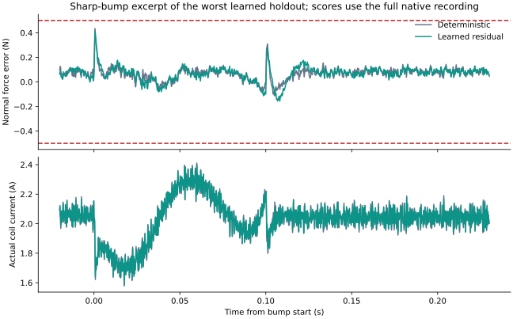

# Small learned force-controller experiment — 2026-10-05

## Intro

This private experiment asks whether a small learned current correction can improve the sanding flange's existing PI and measured-inertia feedforward controller. The physical plant remains the frozen native Simulink acquisition model, SHA256 `b3701daabf1f7a9712511580fe20fde1f10b3d7d83b68b778909d1ff051da1d5`. The experiment uses ADS131M08-like 30 ksample/s conversion, an assumed matched 8 kHz complete sensor response, fresh 10 kHz control, a 100 µs current-response target, and the hot winding model Kf = 24.4 N/A, R = 8.896 Ω, L = 4 mH, with 32 V usable bipolar output. The public model and previous delivered evidence are unchanged.

## Question

Can a 97-parameter neural residual improve the actual workpiece-normal force throughout the sharp bump and subsequent robot recentering, using measured information and already-issued robot predictions?

### Inputs and training

The model has ten inputs and eight ReLU hidden neurons. It updates at 10 kHz and receives reconstructed normal-force deviation, acceleration-feedforward current, observed S–A gap velocity, estimated slope, their four causal 100 µs increments, identified S mass, and the force target. Ordinary Gain, Bias, Saturation, Sum and Unit Delay blocks perform inference. No elapsed time, known bump, future surface, physical force or physical acceleration enters the policy.

Plant truth creates training labels only. The approximate teacher target is

`clip(Kp × (N_est − N_true) − (B_id + S_id)/Kf_id × (aS_true − aS_FF), ±0.05 A)`.

This imitates an approximate correction to proportional feedback and total-mass inertia feedforward. It is not an optimal-action label and omits the compliant lower-link inverse's changed response. The learned action is bounded to ±0.05 A, then added before the existing current notch and limits. Existing antiwindup and robot force-stability gates remain in place.

Eight complete native 4 s recordings supply 320,008 fresh controller frames. Training uses 36,528 frames: all startup and bump-window frames plus regular subsampling of quiet periods. Four separate trajectories supply 160,004 selection frames, of which 18,264 are used for selecting weights. Adjacent samples are never randomly divided between training and test. NumPy Adam trains for 180 epochs with seed 20261005; selected balanced-selection teacher error is 4.784 mA RMS. Twelve further native selection runs compare fixed residual gains 0.25, 0.5 and 1. The predefined minimax rule selects gain 1. Calibration stress is absent from training and selection.

## Results

The main study executes **48 native recordings**, scoring **88,800,048 physical samples**, including startup. The final holdout contains eight nominal trajectories and four calibrated long/mixed trajectories, with a baseline/learned pair for each. Noise seeds differ from training and selection; some parameter endpoints deliberately overlap selection. The stress subset includes two 30 s recordings and two 4 s recordings per controller. It is not an exhaustive calibration-error box.

Both controllers pass all twelve held-out recordings, but the learned controller raises the worst peak from **0.447468 N to 0.468650 N**, reducing force reserve from 0.052532 N to 0.031350 N. Ten paired peak errors worsen and two improve. Mean peak rises from 0.271991 N to 0.277879 N. The maximum paired regression is 0.032867 N. All eight nominal paired peaks worsen.

| Held-out condition | Deterministic peak error | Learned peak error |
|---|---:|---:|
| S = 0.1 kg, 5 N, 90° | 0.047280 N | 0.057573 N |
| S = 0.1 kg, 50 N, 0° | 0.076320 N | 0.095195 N |
| S = 0.5 kg, 5 N, 60° | 0.078770 N | 0.098293 N |
| S = 1 kg, 50 N, 75° | 0.159387 N | 0.174726 N |
| S = 1.4 kg, 20 N, 15° | 0.212796 N | 0.216685 N |
| S = 2 kg, 5 N, 0° | 0.315947 N | 0.348814 N |
| S = 2 kg, 50 N, 90° | 0.326085 N | 0.326170 N |
| S = 2 kg, 35 N, 45° | 0.335044 N | 0.353417 N |
| Calibrated 30 s stress, source index 1 | 0.438256 N | 0.451549 N |
| Calibrated 30 s stress, source index 3 | 0.447468 N | 0.468650 N |
| Mixed 4 s stress, source index 5 | 0.389966 N | 0.375703 N |
| Mixed 4 s stress, source index 7 | 0.436568 N | 0.367769 N |

The learned holdout maximum is 2.443944 A actual coil current and 30.995909 V output, without voltage or ADC clipping. Largest commanded residual is 0.042414 A. The maximum absolute actuator-travel coordinate is 16.152 mm within the model's **0–25 mm** range, whose center is 12.5 mm; this is not a ±16 mm excursion. Contact/travel stops, current and spring-packing checks pass. Force-balance residuals are below 2.85e−14 N.

All logged learned actions match independent numerical inference within 1e−12 A. The saved native graph contains no truth-to-action path, retains every original connected edge and changes only the original current sum from six to seven inputs. A solver check halves the physical step to 1.667 µs for the worst nominal pair: learned peak changes from 0.353416858 N to 0.353417714 N. Two additional 0.1 s software recordings prove zero algebraic loops and exactly identical normal-force, feature and action histories after save/reopen. These checks are additional to the 48 main recordings.

Simulation wall times are retained per recording; they include native simulation, logging and varying compilation/host load. They are not MCU inference benchmarks. The dense layers require 88 weight multiplications per 10 kHz inference, but an embedded deadline remains untested.

## Recommendation

**Retain the deterministic PI and measured-inertia feedforward controller for the prototype.** This particular learned residual fits its approximate teacher, but reduces physical force margin across the held-out set. Keep the trained model as an evaluated alternative. This result does not establish that every ML controller would fail; it establishes that this small sensor-lag imitation attempt does not justify replacing the existing controller. No public-model promotion has occurred.

## Evidence and rerunning

Evidence is under `acf_simulink/validation/ml_force_20261005/`:

- `summary.json`, `training.json`, `selected_gain.json` and `paired_results.csv` contain inspectable results.
- `trained_weights.mat` and `trained_weights.json` preserve weights; MAT SHA256 is `e21982cf35ed2790e831bab0cdd45f76271bfb90b872195c9493bce094fc8b05`.
- `source/` preserves the input native model, eighteen helpers and the initial native neural graph.
- `executed_recipes/` preserves exact recipe versions checked against the recorded execution hashes. The current public recipes additionally accept an alternate output folder for safe reruns.
- `collect/`, `select/`, `test/` and `refine/` preserve input configurations, full-rate controller features, scores and native worst histories. Plot excerpts are display samples; qualification uses every physical sample.
- `causal_graph_audit.json`, `acceptance/results.json` and `final_checks.json` separate graph, software and numerical checks.
- `acceptance/acf_force_control_adc_trial.slx` is the saved private learned candidate, with gain 1 and a 4 s nominal example. Add `source/helpers` to the MATLAB path before using it. It is an experiment, not the recommended prototype controller.

Use fresh output and preference directories, never overwrite this retained study. For example, pass `'/home/tommie/Projects/actuator-model/acf_simulink/validation/ml_force_20261005_replay'` as the third argument to `ml_force_20261005`. Execute phases in this order:

1. Isolated `matlab -licmode onlinelicensing -batch` calling `ml_force_20261005(root,'collect',newStudy)`.
2. `ml_force_20261005_train.py --study newStudy` using the project scientific Python environment.
3. Isolated batch calling `ml_force_20261005(root,'select',newStudy)`.
4. `ml_force_20261005_select.py --study newStudy`.
5. Isolated batch calling `ml_force_20261005(root,'test',newStudy)` and then, separately, the `refine` phase.
6. Isolated batch calling `ml_force_20261005_acceptance(root,newStudy)`.
7. `ml_force_20261005_summarize.py --study newStudy`.

Set a private `MATLAB_PREFDIR` for each process and limit BLAS/OpenMP threads to two. The runner owns its cache/code directories and temporary SDI folder and restores the process's previous SDI storage/recording preference. `ml_force_20261005_build(modelPath,weightsFile,1)` is the reusable native inference builder for other private experiments; the caller supplies prepared parameters and owns saving.
