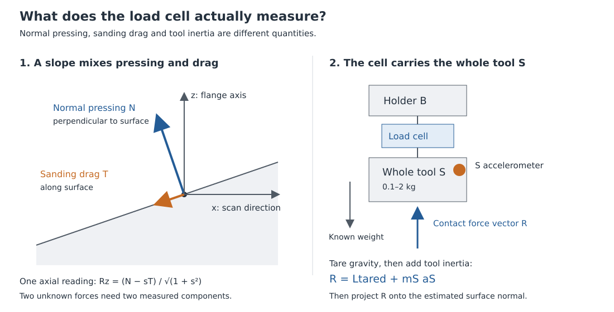
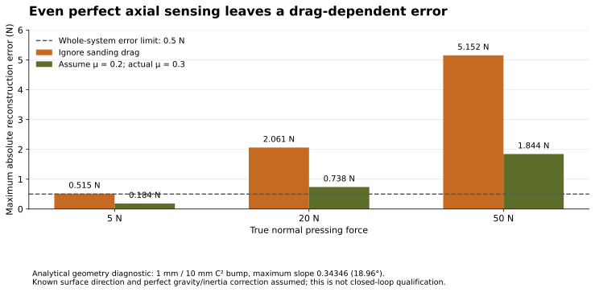
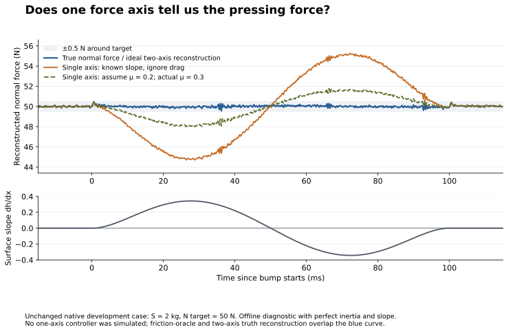

# Load-cell choice: axes, accuracy and stiffness

This note answers which load cell the prototype needs and whether one axis is
enough. It uses the current prescribed 20 N/mm undamped upper spring and rigid
lower attachment with the finite sensing cell. No controller was retuned, no
new closed-loop experiment was performed, and the 736 locked force-test results
are unchanged. The calculations below are analytical or offline diagnostics on
an existing native recording.

## Why the cell reading is not automatically the pressing force

Normal pressing force means the force perpendicular to the workpiece. Sanding
also creates a force along the workpiece. On a slope, part of that drag points
along the flange axis too. A perfectly accurate axial cell therefore reads a
mixture of pressing and drag.



The cell sits between holder B and tool S. It carries the entire S mass, not
the holder B mass. Its reading also changes when S accelerates over the bump.
With the model's signal sign convention, gravity tare and dynamic correction
give

\[
\widehat{\mathbf R}=\mathbf L_{\rm tared}+m_S\widehat{\mathbf a}_S,
\qquad \widehat N=\widehat{\mathbf n}\cdot\widehat{\mathbf R}.
\]

Here **L** is the cell force vector, **a** is tool acceleration, **R** is the
reconstructed contact reaction, and **n** is the unit vector perpendicular to
the surface. Known tool weight removes the static gravity term. It does not
remove inertia: the 2 kg native example needs up to **4.8 N** of dynamic
correction. Force and acceleration must have matched response and timestamps.
Tare must remove gravity with no contact load, or remove a known gravity
contribution explicitly; zeroing the whole loaded cell would also discard the
pressing force we want to measure. A changed orientation needs a new gravity
correction. These equations describe the fixed-orientation translation model;
angular motion needs the additional rigid-body acceleration terms.

## Can we use one force axis?

**For the complete sloped-bump sanding requirement, one flange-axis cell is
not sufficient without extra assumptions or measurements.** That is a
measurement ambiguity, even before ADC noise or control error enters.

For surface slope \(s=dh/dx\), the normal and tangent are
\(\mathbf n=(-s,1)/\sqrt{1+s^2}\) and
\(\mathbf t=(1,s)/\sqrt{1+s^2}\). Let \(T\) be signed sanding drag opposing
the positive scan direction. The contact reaction is
\(\mathbf R=N\mathbf n-T\mathbf t\), so one axial measurement provides only

\[
R_z=\frac{N-sT}{\sqrt{1+s^2}}.
\]

There are two unknown forces, N and T. Perfect knowledge of the surface
direction and tool acceleration does not provide a second force measurement.
Two components solve the problem directly:
\(N=(R_z-sR_x)/\sqrt{1+s^2}\). The current controller uses measured force
components and a causal estimated direction; it does not read the bump shape
or the plant's friction coefficient.

The current C² bump, \(h(q)=64Hq^3(1-q)^3\), reaches slope **±0.34346**,
or **±18.96°**. This local slope is separate from the fixed **0–90°** flange
orientation used to vary gravity. At the native nominal drag ratio
\(T/N=\mu=0.3\), estimating \(N=R_z\sqrt{1+s^2}\) while ignoring drag gives
\(\widehat N-N=-\mu sN\).

| True pressing force | Ignore drag, perfect slope | Assume μ=0.2 when actual μ=0.3 |
|---|---:|---:|
| 5 N | 0.515 N maximum error | 0.184 N |
| 20 N | 2.061 N | 0.738 N |
| 50 N | 5.152 N | 1.844 N |

These are exact geometry diagnostics for constant pressing force. The second
column includes perfect axial sensing, tare and inertia compensation. In the
last column, friction-dependent compensation uses
\(\widehat N=R_z\sqrt{1+s^2}/(1-\widehat\mu s)\). Knowing μ exactly would work
in this ideal model, but that is an oracle comparison: actual sanding drag can
change and the controller is not allowed the plant's μ.



An unchanged current-controller native example at S=2 kg and 50 N produces
**0.458526 N** true force error. Offline, all **600,001 native points** give
**5.160539 N** reconstruction error when drag is ignored despite perfect slope
and inertia correction. Using μ=0.2 gives **1.842831 N**; two perfect force
components recover N to numerical precision. This shows what information is
lost by deleting the transverse measurement. It is not a one-axis controller
qualification or a result from retuning that controller.

Perfect-sensor reconstruction is not the actual acquisition performance. The
same record's acquired two-axis estimate differs from present-time true N by
up to **0.653183 N**, compared with **5.305504 N** after removing its lateral
component and ignoring drag. This comparison uses the 20,001 actual 10 kHz
observation timestamps; it includes sensing noise, response, delay and direction
estimation. It is neither the closed-loop force error nor an isolated ADC
accuracy result. The acquired two-axis formula matches the executing estimator
exactly; its real acquisition errors remain to be improved and qualified.



The separate [ambiguity figure](../../../validation/report_readability_20261006/loadcell/single_axis_force_ambiguity.svg)
shows different possible normal forces producing the same axial reading as
μ varies from 0 to 0.6. That interval is an illustrative sensitivity scenario,
not a measured friction bound or confidence interval. Reversing drag changes
the signs; it does not remove the ambiguity.

One axis can be adequate for a **restricted flat-surface prototype**, with its
sensing axis perpendicular to the surface and sufficiently characterized
off-axis rejection. Alternatively, an extra drag measurement or a mechanically
normal-aligned sensor could supply the missing information. Those are changed
sensor/contact assumptions and need separate modeling and testing. Do not
silently apply the current sloped-bump results to them.

## Do we need two, three or six axes?

**Two force axes suffice for the present planar model. Three force axes are
the appropriate starting target for physical 3D sanding.** A six-axis cell adds
three moments, not another three force directions. Moment measurements are
useful for contact eccentricity, tilting and load-cell diagnostics, but are not
mathematically necessary just to compute \(\mathbf n\cdot\mathbf R\).
Arbitrary 3D motion also needs the corresponding acceleration components and
a 3D surface-normal estimate; the present two-axis planar acquisition does
not qualify that extension.

The sensor must still survive bending and spindle torque even if it does not
measure them. For example, 50 N acting 100 mm from a mounting point produces
**5 N·m** of bending moment. The actual lever arms, gravity load and spindle
torque determine the required combined-load envelope.

Six raw strain channels of an integrated six-axis cell are usually mixed
through a calibration matrix into Fx, Fy, Fz, Mx, My and Mz. They are not six
independent force channels. Omitting moment outputs does not generally allow
omitting raw inputs. A genuine three-axis cell with three independent bridge
outputs could use fewer ADC channels, but its stiffness and calibration must
be evaluated separately. [ATI DAQ matrix conversion](https://www.ati-ia.com/app_content/documents/9620-05-DAQ.pdf),
[Interface three-axis example](https://www.interfaceforce.com/products/multi-axis-sensors/3-axis-sensors/3a60a-3-axis-force-load-cells/).

## What capacity and accuracy should we specify?

Across the **736 locked tests**, the true raw axial cell load before tare spans
**−18.885 to +59.803 N**. Approximately **±100 N axial measuring capacity** is
a defensible development target with reserve. It should support both tension
and compression: even positive pressing force can require a reversed support
load when gravity carries a heavy tool. The acquisition's existing
**±160 N** scaling is electronic headroom, not a demonstration that the cell
must be rated to ±160 N. Transverse capacity must include drag and tool
weight: a conservative combination of the present maximum bump slope,
50 N pressing, μ=0.3 and 2 kg gravity is about **50 N**. Approximately
**±100 N transverse capacity** is a reasonable initial envelope target, with
the combined force/moment chart checked for the actual mounting. These finite
simulation loads do not size collisions or first-contact impacts.

Do not allocate all ±0.5 N to the load cell: control dynamics, acceleration,
direction estimation and timing also contribute. Retain development targets
of **±0.01 N residual zero per force axis**, **±0.05% calibrated gain and
cross-axis residual**, and **±0.05° relative frame alignment**. At the maximum
bump slope, two ±0.01 N axis biases alone can contribute about **0.0127 N**
normal error. A 0.05° normal-direction error mixes in about **0.0131 N** of
the 50 N/μ=0.3 tangential load. These are error-budget targets, not catalog
guarantees and not proof the current controller will pass.

Manufacturer **percent-full-scale** accuracy is not percent of the 5 N
reading. For example, the current Interface 3A60A page specifies ±0.2% FS
nonlinearity and ±0.5% FS hysteresis: at 200 N, these are **±0.4 N** and
**±1 N** respectively. That sensor has enough axes but its published limits
do not establish our calibration target. Extra ADC bits do not remove
mechanical hysteresis. Exact-unit calibration, temperature behavior and
off-axis load tests are essential. [Current manufacturer specifications](https://www.interfaceforce.com/products/multi-axis-sensors/3-axis-sensors/3a60a-3-axis-force-load-cells/).

## Why stiffness and the electronics interface matter

A load cell must deform slightly to sense force. The model's **64 MN/m** is
a realistic representative axial stiffness: ATI's Mini27 Titanium publishes
that value. Other compact cells differ considerably: Mini40 **20 MN/m** and
Mini45 **98 MN/m**. The installed frame and attached masses matter too.
A catalog standalone resonance does not give the flange's loaded resonance.
Reidentify the real cell/mounting response before using the selected narrow
cell feedback; changing stiffness moves the vibration it targets.
[Mini27 Titanium](https://www.ati-ia.com/products/ft/ft_models.aspx?id=Mini27+Titanium),
[Mini40](https://www.ati-ia.com/products/ft/ft_models.aspx?id=Mini40),
[Mini45](https://www.ati-ia.com/products/ft/ft_models.aspx?id=Mini45).

An **analog bridge needs an amplifier and digitizer** for a digital controller.
A **digital-output load cell already contains that electronics**, so a
separate force ADC chip is optional. Compare the total sensor/electronics
cost and actual fresh-sample timing. ATI's current RS485 Axia example has a
highest internal rate of **7,812 sample/s** and explicitly distinguishes
sample rate from packet rate: fast packets can repeat old readings. It is
not a qualified replacement for the modeled synchronized 30 ksample/s chain.
[ATI interface comparison](https://www.ati-ia.com/products/ft/ft_SystemInterfaces.aspx),
[RS485 Axia manual](https://www.ati-ia.com/app_content/Documents/9610-05-RS485%20Axia80.pdf).

## Recommendation and reproducibility

For the complete bump requirement, keep at least **two independently
reconstructed force components** in the planar demonstrator. For 3D sanding,
prefer a stiff calibrated **three-force-axis or six-axis cell** in the complete
B–S load path, chosen by combined load ratings, installed dynamics and
calibrated absolute error. Retaining six raw bridge inputs preserves the
current six-axis acquisition assumption; a three-bridge option is a separate
potential cost reduction, not a proven equivalent part.

The calculation script is `analyze_loadcell.py`. Run it using an existing
numpy/scipy/matplotlib environment, for example:

```bash
/home/tommie/Projects/simulateanchors/.venv/bin/python \
  acf_simulink/experiments/report_readability_20261006/loadcell/analyze_loadcell.py
```

[Numerical evidence and source hashes](../../../validation/report_readability_20261006/loadcell/loadcell_evidence.json)
bind the original SLX, native trace, contract and qualification result JSONs.
[Manufacturer source review](../../../validation/report_readability_20261006/loadcell/manufacturer_sources.json)
records primary URLs, exact specifications and one historical/current
hysteresis disagreement. CSVs retain all plotted rows and exact diagnostic
metrics. Figure metrics use every native point; the native display retains
per-bin extrema. No scientific input, canonical model or final-test outcome
was changed.
