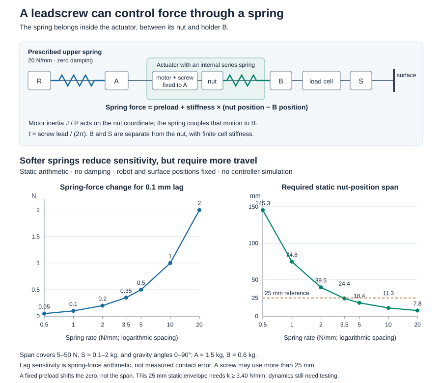

# Leadscrew with an actuator-internal series spring

This corrects the comparison question for **our flange**, independently of the
group member's polishing script. A leadscrew need not make B follow its nut
rigidly. A spring between the nut and B converts their relative displacement
into actuator force. It belongs inside the actuator: the prescribed upper R–A
spring remains **20 N/mm with zero damping**, and B–S remains rigid apart from
the **64 MN/m sensing cell**.

The nut and holder are separate mechanical coordinates. For screw lead divided
by `2π` denoted by `ell`, motor inertia reflects as `J/ell²` onto the **nut**
coordinate. It is coupled through the spring to B; it is not automatically added
to tool mass. A spring-coupled screw requires a different dynamic plant and its
own controller tuning. Existing direct-drive screw tests cannot rank this design.

## What this bounded calculation establishes

With no added external spring damping, a relative displacement change of
0.1 mm changes spring force by `k × 0.1 mm`. A softer spring therefore reduces
force sensitivity to nut-to-holder lag, at the expense of more spring deflection
and nut travel. These are **arithmetic sensitivities, not closed-loop contact
error or sharp-bump simulation results**.

The static envelope holds robot and tool positions fixed while covering force
5–50 N, gravity angles 0–90°, and S = 0.1–2 kg, with A = 1.5 kg and B = 0.6 kg.
The flange axis is aligned with the workpiece normal; drag is excluded. Axis
gravity is `g*cos(theta)`, with theta = 0 oriented toward the contact.

In SI units, with spring stiffness `k_s`,

```text
F_cell  = F - S*g*cos(theta)
F_s     = F - (B+S)*g*cos(theta)
F_upper = F - (A+B+S)*g*cos(theta)
q       = F_upper/k_upper + F_s/k_s + F_cell/k_cell
```

Here `q` is nut position relative to A, with arbitrary fixed position/preload
zero. A constant preload subtracts a constant `preload/k_s` from q, so it shifts
the zero without shrinking the span. A longer screw, robot recentering or manual
preload changes between operating configurations changes the envelope. **25 mm
is only the old actuator-stroke reference, not a necessary leadscrew limit**.

The ideal element is bidirectional. At 5 N, S = 2 kg and theta = 0°, its static
force is negative. A physical design needs a tension/compression arrangement or
opposed/preloaded springs; this arithmetic does not establish part feasibility.
The fixed-robot span is 4.2614 mm from upper/cell compliance plus
`70.49729 N / rate(N/mm)` from the new actuator spring. Dynamic travel reserve,
motor torque/thermal limits, backlash, tool inertia, cell/frame modes, spring
packaging and controller stability remain untested.

## Reproduce and inspect

From the project root:

```bash
python acf_simulink/experiments/series_elastic_comparison_20261006/build_tradeoff.py
```

No MATLAB process, simulator, training, MAT/NPZ file or full history is produced.
The script checks the shared 5 GiB evidence-array budget and filesystem free
space **before calculating**. Retained source, JSON and figure forecast is
≤250 kB; temporary forecast is ≤1 MB. Its streamed grid constructs coordinates
independently from all three static force balances: 91 forces × 39 tool masses ×
181 gravity angles for each of seven spring rates. Only scalar extrema are kept.

Checks cover endpoint extrema, force balance, constant-preload span invariance,
monotonic sensitivity/travel tradeoff, and the infinitely stiff actuator-spring
limit. They validate the algebra, not force qualification. The complete formulas,
assumptions and compact results are in
[`static_tradeoff.json`](../../validation/series_elastic_comparison_20261006/static_tradeoff.json).


