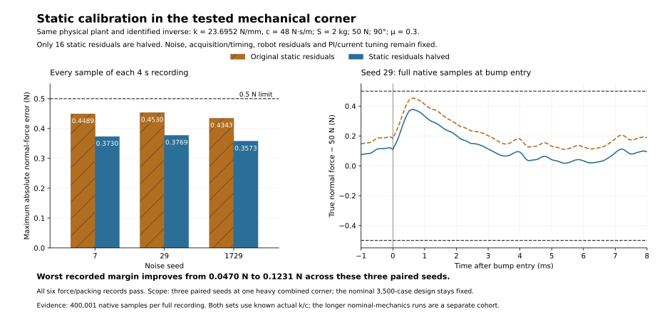

# Static calibration at the identified mechanical stress corner

Our goal is to keep the workpiece's normal pressing force within ±0.5 N throughout the recording, including the 1 mm high, 10 mm wide bump at 100 mm/s. The wider nominal design covers S=0.1–2 kg, force targets 5–50 N and orientations 0–90°. This follow-up examines **three paired seeds at one heavy combined mechanical/calibration corner**.

All three new 4 s native histories passed force accuracy and spring packing. With assembled spring/damper values supplied to the inverse, halving the 16 static calibration residuals reduced the worst error from **0.453025760 N to 0.376938079 N**. The remaining margin increased from **0.046974240 N to 0.123061921 N**. The comparison reuses the three retained known-actual-k/c records; it adds exactly three force simulations.

| Noise seed | Original static residuals | Static residuals halved | Peak-error reduction |
|---:|---:|---:|---:|
| 7 | 0.448923234 N | 0.373043910 N | 0.075879323 N |
| 29 | 0.453025760 N | 0.376938079 N | 0.076087681 N |
| 1729 | 0.434300063 N | 0.357305057 N | 0.076995006 N |



## Exact changes and fixed conditions

Both sets use B=0.6 kg, S=2 kg, 50 N, 90°, μ=0.3, actual aggregate lower stiffness **23,695.2 N/m** and lower damping **48 N·s/m**. These are +20% stiffness and −20% damping relative to the selected nominal lower link. The inverse already uses those known actual k/c values in both sets. The upper attachment remains rigid, and every spring/damper support load passes through the B–S load cell.

The new recipe starts from each baseline history's complete returned parameter structure. It halves only the 16 specified static residuals around their actual values and updates their required identified-mass/force-constant coefficient dependencies. Every other primitive and all other derived coefficients must remain exactly equal. The returned native parameters must also equal the prepared parameters frozen before simulation. All three guards passed.

| Tested static residual group | Number of primitives | Original magnitude | New magnitude |
|---|---:|---:|---:|
| Force bias, z and x | 2 | 0.02 N | 0.01 N |
| Force gain, z and x | 2 | 0.1% | 0.05% |
| Force and accelerometer frame angle | 2 | 0.1° | 0.05° |
| Force cross-talk, z←x and x←z | 2 | 0.1% | 0.05% |
| Accelerometer bias, z and x | 2 | 0.01 m/s² | 0.005 m/s² |
| Accelerometer gain | 1 | 0.5% | 0.25% |
| Identified S, B and coil force constant | 3 | 0.5% | 0.25% |
| Position gain | 1 | 0.1% | 0.05% |
| Identified scan-speed gain | 1 | 0.1% | 0.05% |

The tested signed errors have these magnitudes; this table gives calibration targets to verify on the prototype. It does not qualify every combination inside a continuous 16-dimensional error box. The exact signed values are in [the chart data](inertial_mechanics_calibrated_static_mixed_comparison_20260930_chart_data.json) and the prepared configurations. Identified B changes from 0.603 to 0.6015 kg, identified S from 1.99 to 1.995 kg, and identified Kf from 20.1 to 20.05 N/A. The actual B, S and Kf remain 0.6 kg, 2 kg and 20 N/A.

PI stays at 0.3 A/N and 20 A/(N·s), with the 1 kHz feedback rolloff and 1.5 kHz proper lower-load inverse. Current response stays at 100 µs with the generic 24 V coil provision. Noise, actual and identified acquisition/filter/pipeline timing, robot delay/response residuals, robot gain, command prediction, measured-drag geometry and force-stability gate remain unchanged. No surface preview is introduced.

## Native histories, effort and packing

Each metric uses all **400,001 native samples**, including startup: maximum absolute true normal force minus 50 N over 4 s at a 10 µs integration step. The seed-29 peak moves from 2.00064 s to 2.00063 s. The entry figure uses every native sample in its displayed window; the bars use the complete recordings.

The new records reached **2.998686 A** and **21.952910 V**. No run clipped current or voltage, lost contact or reached a travel stop. Native axial and lower-link force balances remain within 5×10⁻¹⁵ N. The fixed 33.6 N common preload lies within the three-case feasible intersection **30.954449–40.550451 N**. Combined free and installed spring lengths are **40.980 and 35.307965 mm**, respectively. These are spring-only packing bounds, using the approximate 20 mm free-length target.

This paired result supports improving static calibration after identifying the assembled lower-link stiffness/damping. It covers three seeds at one heavy combined corner, with exact known k/c. It does not establish an identification-error allowance, nonlinear damper behavior or physical prototype performance. The nominal 3,500-case candidate and the longer nominal-mechanics calibration records remain separate and unchanged.

## Reproduction and source binding

The original calibrated donor was `/home/tommie/.local/state/actuator-model/tpba1927d1_c384_4398_a279_c8cfe77fab78/`. Its native model SHA is `4ac684797c4a41d3a73c8146357baa97ba18098415b3940c942762330e2d3a4b`; the underlying scientific V8 model SHA is `73bbc46529f3c28d51d17766c4b0042d278446d29b5fdb21910f93c310937643`. The final nominal candidate remains SHA `d8c49dd39bbb3417c294a79ebb061efdff04d2625b91794066d7b8ad087979c7`.

The [new portable input snapshot](inertial_mechanics_calibrated_static_mixed_source_20260930/portable_input_manifest.json) preserves a byte-identical model/helper copy, original joint configurations, the pre-simulation three-case configuration, and the frozen recipe. It names and hashes the original known-actual native inputs retained alongside the snapshot. The earlier portable source and evidence are preserved. Copying inputs and making the figure adds zero force simulations.

Use an isolated `matlab -batch` process with private `MATLAB_PREFDIR`. From the repository root, this MATLAB code reads the retained original baseline parameters and writes three fresh histories:

```matlab
baseline = fullfile(pwd, 'acf_simulink', 'validation');
source = fullfile(baseline, ...
    'inertial_mechanics_calibrated_static_mixed_source_20260930');
addpath(fullfile(source, 'recipes'), '-begin');
output = tempname;
mkdir(output);
result = inertial_mechanics_run_calibrated_static_mixed_20260930( ...
    source, output, baseline);
```

The recipe accepts the baseline folder explicitly, freezes all three prepared configurations before the first simulation, uses private native model/cache/code/SDI directories and restores SDI settings. It contains no physical plant solver. The [result JSON](inertial_mechanics_calibrated_static_mixed_20260930_results.json), [invocation manifest](inertial_mechanics_calibrated_static_mixed_20260930_invocation_manifest.json), [figure manifest](inertial_mechanics_calibrated_static_mixed_comparison_20260930_figure_manifest.json) and [evidence manifest](inertial_mechanics_calibrated_static_mixed_comparison_20260930_evidence_manifest.json) bind the configurations, six paired histories and exported graph.

**Prototype recommendation:** measure the assembled lower spring/damper response, enter the identified k/c, and verify the tighter static calibration targets with the complete synchronized sensing chain. In this targeted paired study, the same PI/current/acquisition design recovered a further 0.076 N of worst-case force margin through calibration alone.
