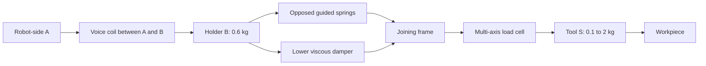
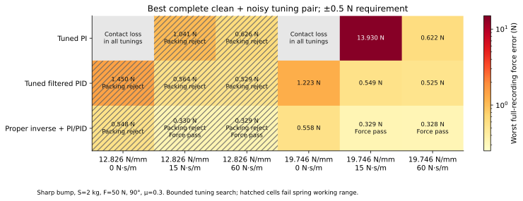
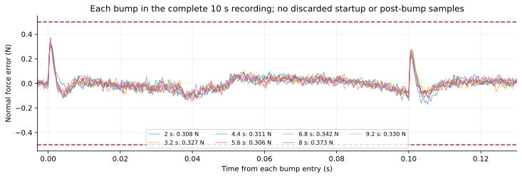

# Lower-series mechanics and causal inverse feedforward

The design goal is to keep the workpiece's normal pressing force within ±0.5 N for the complete recording, including a 1 mm by 10 mm sharp bump scanned at 100 mm/s. The intended range is 5–50 N, fixed flange orientations 0–90°, tool mass S=0.1–2 kg and holder mass B=0.6 kg. This note records the bounded mechanical/controller studies; the combined final acquisition model and full qualification remain separate.

## Selected mechanical provision

Use a rigid robot-side attachment and a guided opposed compression-spring pair in the lower load path. Put its damper in parallel with the pair, and put the multi-axis load cell downstream of the spring/damper joining frame. All supporting spring and damper forces must pass through the sensing element before reaching S.

| Quantity | Selected target |
|---|---:|
| Individual spring rate | 9.873 N/mm |
| Combined pair rate | 19.746 N/mm |
| Individual nominal free length | 18.1 mm |
| Free-length allowance per spring | ±0.49 mm |
| Individual minimum working length | 10.55 mm, plus 0.5 mm clearance |
| Individual force envelope used in packing | 68.543 N |
| Common preload per spring | 33.6 N |
| Parallel lower damping | 60 N·s/m |
| Combined maximum free length | 37.18 mm |
| Combined maximum installed length | 30.374 mm |

The geometry and force envelope are compact-spring reference values from [spring_catalog.json](../experiments/spring_catalog.json). They are approximate prototype targets, rather than a purchasing list. The total-length checks apply only to springs; they do not determine the overall length of the actuator, guides, load cell and flange.

The selected 10 s worst recording required 5.70–61.50 N per spring, with compression 0.577–6.230 mm. Its lower relative speed reached 33.17 mm/s. The 60 N·s/m damper then carried 1.99 N peak, dissipated 0.066 W peak and averaged 1.48 mW over that recording. The damper therefore needs a repeatable force–velocity response at small bidirectional forces; the model does not qualify a real damper's breakaway friction or nonlinear velocity dependence.

## Why the additional feedforward is needed

A compliant lower link changes how actuator force reaches the tool. The earlier common rigid-link PI gains are therefore not a fair test of a spring assembly. We separately tested substantially larger PI gains, filtered PID and a proper causal inverse of the lower spring/damper load path.

With maintained contact and upper attachment rigid, the native mechanics obey

\[
R_z=F_a+B(g+a_B)+S(g+a_S),\qquad
R_z=Q_1+S(g+a_S).
\]

Here \(R_z\) is the axial component of reconstructed contact reaction, \(Q_1\) is the total lower spring/damper force and \(F_a\) includes actuator friction. The controlled normal force is obtained from the contact-force vector and the causal estimated local surface direction. The controller receives measured/tared multi-axis load-cell channels, measured S acceleration, S relative to A and the prediction of robot commands already issued. It receives no bump-profile preview.

For small deviations, the desired lower load is

\[
\delta Q_{1,\mathrm{ref}}=\delta R_{z,\mathrm{ref}}-\hat m_S\,a_{S,\mathrm{measured}}.
\]

The baseline measured-acceleration current feedforward assumes B follows S. The added branch corrects the holder-inertia difference caused by the lower link:

\[
I_{\mathrm{extra}}=
\frac{\hat m_B}{\hat K_f}
\frac{s^2}{\hat k_1+\hat c_1s}
\frac{\omega_f^2}{s^2+2\zeta_f\omega_fs+\omega_f^2}
\delta Q_{1,\mathrm{ref}}.
\]

This is a causal, proper transfer function of measured and commanded signals, with zero DC output and stable denominator poles. Its two-pole rolloff limits high-frequency derivative effort. It adds three discrete states implemented by an ordinary native **Discrete Transfer Fcn** block; it does not replace the physical plant with a MATLAB solver. The 10 s worst trace required 0.497 A peak in this extra branch, equivalent to 9.94 N at the nominal 20 N/A force constant.

The selected force feedback uses P=0.3 A/N, I=20 A/(N·s), D=0 and a feedback-only second-order 1 kHz lowpass with damping 1/√2. The inverse rolloff is 1.5 kHz with damping 1/√2. Measured drag-ratio geometry feedforward uses a 5 ms guarded estimate, and guide-friction feedforward uses a 400 µs causal velocity lead. Total-current notch filtering is disabled. The baseline source assumes matched 100 µs force/acceleration response and 100 µs acquisition delays, with a 100 µs current response. The combined raw acquisition and stability gate source needs its own recordings.

## Executed comparison

All force errors below use every original native recorded sample, including startup. A contact-loss or travel-stop recording fails. Search packing checks determine whether a feasible common preload exists; the selected-source repeated and refinement runs additionally enforce the actual configured 33.6 N preload.

| Study | Executed native cases | Result |
|---|---:|---|
| Fair larger PI gains, lower pair 12.826/19.746 N/mm, damping 0/15/60 | 108 | No force passes; strongest complete compact-pair design still exceeded 0.62 N |
| Filtered PID over the same mechanical shortlist | 36 | No force passes; best complete compact-pair design was 0.525 N |
| Proper inverse cutoff/gain pilot at 19.746 N/mm, 60 N·s/m | 24 | 22 force/packing passes; selected P=0.3/I=20, inverse 1.5 kHz gave 0.328 N |
| Inverse mechanics shortlist: 12.826/19.746 N/mm, damping 0/15/60, cutoff 600/1500 Hz | 24 | 16 force passes; eight jointly passed force and packing |
| Selected lower-series short endpoints | 32 | All passed; worst 0.328 N |
| Selected lower-series 10 s repeated bumps, heavy noisy seeds 7/29/1729 | 3 | All passed; worst 0.373 N |
| Selected lower-series RK4 solver refinement, 10/5/2.5 µs, clean and noisy | 6 | All passed; maximum peak change 11.852 µN |
| Inverse-model identification, k and c independently ±20%, actual plant fixed | 18 | All passed; worst 0.362 N |

The 12.826 N/mm pair can satisfy the force metric with inverse feedforward and damping, but its working-load/length envelope rejects the heavy 50 N design. The 19.746 N/mm pair with 15 N·s/m damping also passed the bounded inverse shortlist, using a small filtered derivative term. The selected 60 N·s/m case uses PI alone and has its own repeated-run evidence.

Removed springs were tested as rigid links. Zero external damping was also tested while retaining intrinsic actuator friction. In the final lower-series shortlist, zero external damping did not pass the clean/noisy force cohort: the best complete inverse pair exceeded 0.55 N, and the aggressive 1.5 kHz zero-damping case amplified noise to several newtons. These results do not justify treating an ideal undamped spring as an equally qualified substitute.

The heatmap shows the minimum worst force error among complete, equal clean/noisy tuning pairs for each tested mechanical design and strategy. Hatched cells fail the spring working-range screen. This bounded optimization does not imply that untested tunings, materials or actuator topologies fail.

## Repeated bumps and convergence

The selected source passed seven sharp bumps at 1.2 s intervals in each 10 s heavy-tool recording. Peak errors were 0.358007 N, 0.372629 N and 0.358901 N for seeds 7, 29 and 1729. No contact, travel, current or voltage limit was reached. Across these recordings, maximum actual current was 2.96479 A and maximum required voltage was 17.93756 V under the nominal 3.5 A/24 V provision.

The three complete recordings share an admissible preload interval of **30.3780–36.8571 N per spring**. The configured 33.6 N lies inside it. The physical and normal contact balances are checked from the full native histories; full failed histories and preparation rejects remain separate.

The full-recording plot uses native min/max envelopes solely for display; the qualification metric is computed before any plot reduction. The detailed overlay shows each bump separately.

At native RK4 steps 10, 5 and 2.5 µs, the noisy peak was 0.328079499, 0.328084141 and 0.328091351 N. The clean peak was 0.326401522, 0.326401535 and 0.326402600 N. These differences are small relative to the remaining nominal force margin; the result is not a coarse-step numerical artifact.

The independent bandwidth worker additionally completed 80 selected-source sharp endpoints at S=0.1/2 kg, F=5/50 N, angle=0/90°, μ=0/0.3 and clean/seeds 7/29/97/1729. All passed; its worst was 0.335703904 N. Those recordings belong to the [bandwidth endpoint study](normal_mass_controller_inertial_endpoint_confirmation_20260930_lower_series_v1_results.json), rather than the mechanics execution count.

## Interpretation for a prototype

The inverse sensitivity changes the **identified** k/c values while keeping the actual nominal springs and damper fixed. It demonstrates that those 18 specific inverse-model estimation errors pass the 4 s heavy-tool cohort. It does not establish actual manufacturing tolerance. The requested separate 72-case actual-k/c ±20% plan is [prepared but unexecuted](inertial_mechanics_actual_sensitivity_plan_20260930.json), awaiting the final combined acquisition source. It will retain the same identified inverse and enforce spring geometry and preload independently.

The spring/damper joining frame and cell stiffness also matter physically. The baseline lower link models their series cell compliance as massless and negligible relative to 19.746 kN/m; a 64 MN/m cell changes static stiffness by about 0.031%. A real nonzero joining-frame mass creates another cell/fixture mode. That mode, lateral compliance, guide alignment, friction, damping and distributed sanding-pad contact require prototype identification and a suitably conditioned sensor path. They are not qualified by the present single lower-link idealization.

S relative to A is the approved position measurement. With this compliant link it differs from actual coil gap; the worst repeated recording showed a 0.434 mm difference. The observer remains a causal S–A observer, and guide-friction feedforward approximates B velocity with S velocity. The force balance and inverse control use the real lower-link dynamics; actuator travel protection uses the native actual coil gap. A physical prototype must also protect actual actuator stroke rather than treating S–A as an exact magnet-gap measurement.

The mechanical recommendation is therefore a **rigid upper attachment, compact opposed lower spring pair near 20 N/mm combined, 33.6 N preload per spring, and roughly 60 N·s/m low-stiction lower damping, with all loads routed through the downstream multi-axis cell**. Use the selected causal proper holder-inertia inverse plus PI as the starting controller. Preserve force/acceleration timing and identify the actual assembly before relying on the nominal margin.

## Reproduction and evidence

The immutable baseline source is `/home/tommie/.local/state/actuator-model/inertial-mechanics-selected-lower-series-20260930/lower_series_v1`. Its model SHA256 is `a0c2e358503d51c53c630ca436f20c1a618c5d024f98dd46338ee328f6c94f81`. The selected parameter MAT and every helper hash are bound by [the source manifest](inertial_mechanics_lower_series_v1_manifest_20260930.json). The Model Workspace stores the selected parameters. [The owned recipe](../experiments/qualify_inertial_mechanics.m) copies model/helpers into private batch-run directories and preserves the frozen source.

The [evidence index](inertial_mechanics_evidence_index_20260930.json) records all mechanics executions by model version. Its historical count includes failed intermediate controllers and repeated/refinement cases; it is not the final design-point count. [Figure hashes](inertial_mechanics_figure_manifest_20260930.json), [reviewed spring chart data](inertial_mechanics_spring_chart_data_20260930.json), and [native power/packing trace audit](inertial_mechanics_selected_trace_review_20260930.json) bind the displayed figures and prototype targets to their actual records.
