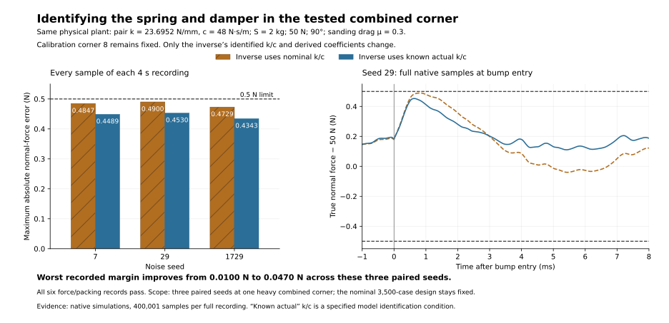

# Mechanical identification at the combined calibration corner

Our goal is to hold the workpiece's normal pressing force within ±0.5 N throughout the recording, including the 1 mm high, 10 mm wide bump at 100 mm/s. The wider nominal design covers S=0.1–2 kg, force targets 5–50 N and orientations 0–90°. These six additional histories examine **one heavy combined stress corner**, separately from that nominal grid and the longer calibration records.

All six 4 s native runs passed both force accuracy and spring packing. With actual pair stiffness +20% and actual damping −20%, leaving the inverse at nominal mechanics produced a worst error of **0.489995725 N**. Supplying the known assembled stiffness/damping reduced it to **0.453025760 N**, increasing the remaining margin from **0.010004275 N to 0.046974240 N**.

| Noise seed | Nominal identified k/c | Known actual identified k/c | Peak-error reduction |
|---:|---:|---:|---:|
| 7 | 0.484706540 N | 0.448923234 N | 0.035783306 N |
| 29 | 0.489995725 N | 0.453025760 N | 0.036969965 N |
| 1729 | 0.472902726 N | 0.434300063 N | 0.038602663 N |



## What was held fixed

The physical plant uses B=0.6 kg, S=2 kg, 50 N, 90°, μ=0.3, actual aggregate lower stiffness **23,695.2 N/m** and lower damping **48 N·s/m**, with the upper attachment rigid. All spring/damper support loads pass through the B–S multi-axis cell. Each spring's actual rate is 11,847.6 N/m. Free length is the approximate 20 mm target and common preload stays at 33.6 N per spring.

Both cohorts preserve calibration corner 8's complete 26-residual configuration: force/IMU alignment and cross-talk, force/acceleration bias and scale, identified masses and force constant, acquisition mismatch and actual robot delay/response. Identified B=0.603 kg, Kf=20.1 N/A and S=1.99 kg remain fixed. The nominal inverse uses k=19,746 N/m and c=60 N·s/m; its counterpart uses the known physical k=23,695.2 N/m and c=48 N·s/m. A whole-parameter equality guard proves that **only those two inverse identification fields and their numerator/denominator arrays change**.

PI remains 0.3 A/N and 20 A/(N·s), with 1 kHz feedback rolloff and the 1.5 kHz proper inverse. Current response remains 100 µs at 24 V. Raw 100 kHz acquisition, matched anti-alias conditioning, 10 kHz control frames, measured drag geometry, issued-command prediction and the force-stability gate are unchanged. There is no surface preview.

The metric is the maximum absolute **true normal force minus 50 N** over every one of 400,001 native samples, including startup. The original mixed seed 29 peak occurs at 2.00082 s; its identified-actual counterpart peaks at 2.00064 s. The plotted entry window contains every native sample in that window and the bars use the whole recording.

## Effort, packing and scope

The original mixed cases reached 2.96017 A and 19.11600 V. The known-actual cases reached 3.00447 A and 21.33190 V. No case clipped current or voltage, lost contact or reached a travel stop. Native axial and lower-link balances remain within 5×10⁻¹⁵ N.

The original mixed preload intersection is 30.958238–40.546662 N; the known-actual intersection is 30.978294–40.526606 N. Both contain the fixed 33.6 N setting. Combined free and installed spring lengths are 40.980 and 35.307965 mm. These are spring-only packing bounds.

This comparison supports measuring and entering the assembled spring/damper values. Its scope is three seeds at one combined corner, with known k/c supplied exactly to the model. It does not establish a continuous combined tolerance region, a k/c identification error allowance, nonlinear damper behavior or physical prototype performance. The longer nominal-mechanics calibration histories remain a separate experiment. The main 3,500-case candidate is unchanged.

## Reproduction and preserved inputs

The original calibrated donor was `/home/tommie/.local/state/actuator-model/tpba1927d1_c384_4398_a279_c8cfe77fab78/`. The executed clone was `/home/tommie/.local/state/actuator-model/inertial-mechanics-mixed-corner8-20260930/frozen-calibrated-source/`. The recorded native source SHA is `4ac684797c4a41d3a73c8146357baa97ba18098415b3940c942762330e2d3a4b`, with the scientific V8 base SHA `73bbc46529f3c28d51d17766c4b0042d278446d29b5fdb21910f93c310937643`.

A byte-identical portable snapshot is [inertial_mechanics_mixed_source_20260930](inertial_mechanics_mixed_source_20260930/portable_input_manifest.json). It contains the SLX, helpers, original joint configurations and frozen recipes. The source configuration SHA is `a766e3ec847544f491ac21388c0b9965258373849fcf41d521122e58b9632bb2`. Original configuration indices 8, 18 and 28 supply seeds 7, 29 and 1729. The known-actual prepared configuration is retained as `inertial_mechanics_calibrated_mechanics_20260930_configuration.mat`, SHA `3ecea65676d370258032e928327ef0a4262975e6eea0a048e976f4d37a12848c`.

Use an isolated `matlab -batch` process with private `MATLAB_PREFDIR`. From the repository root, this MATLAB code writes six new histories to a fresh folder and preserves the recorded evidence:

```matlab
source = fullfile(pwd, 'acf_simulink', 'validation', ...
    'inertial_mechanics_mixed_source_20260930');
addpath(fullfile(source, 'recipes'), '-begin');
output = tempname;
mkdir(output);
mixed = inertial_mechanics_run_mixed_corner_20260930(source, output);
identified = inertial_mechanics_run_calibrated_mechanics_20260930(source, output);
```

The second recipe reads the first recipe's exact returned parameters, freezes the three new configurations before simulation and preserves every other parameter. Both recipes use private model/cache/code/SDI directories and restore the process's SDI settings. They require the recorded native source and ordinary Simulink blocks; neither implements a hidden plant solver.

The two result files are [original mixed3](inertial_mechanics_mixed_worst_corner_20260930_results.json) and [known-actual3](inertial_mechanics_calibrated_mechanics_20260930_results.json). Each names and hashes all three complete native histories. Their invocation manifests preserve the exact recipes and input identities; [the comparison figure manifest](inertial_mechanics_mixed_comparison_20260930_figure_manifest.json) binds its reviewed metrics and plotted histories. Creating the portable copy and figure adds zero simulations.

**Prototype recommendation:** retain the selected coil, PI and causal inverse architecture, characterize the assembled lower spring/damper response, enter the identified k/c in the inverse, and repeat the force tests with the physical acquisition chain. This targeted simulation recovers about 0.037 N of peak-error margin through mechanical identification alone.
