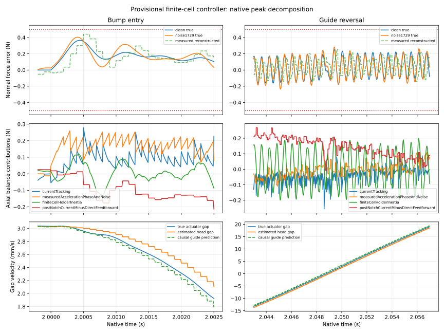

# Provisional finite-cell peak decomposition

These are original full-grid native recordings. The controller remains provisional because longer recordings and frequency mismatch fail.

| Case | Time (s) | True normal error (N) | Reconstructed N (N) | Cell holder inertia (N) | Acceleration phase/noise (N) | Current tracking (N) |
|---|---:|---:|---:|---:|---:|---:|
| clean | 2.00044 | 0.365363 | 50.232346 | 0.082945 | 0.184423 | 0.098190 |
| noise1729 | 2.00041 | 0.404199 | 50.300555 | 0.115479 | 0.143815 | 0.131362 |

Both full-record peaks occur at bump entry, before guide friction reverses. The additive force-balance contributions show synchronized sensing delay and current tracking combined with finite-cell B inertia. In the reversal window, a roughly 1.65 kHz component matches the 1.644 kHz nominal cell mode within Welch-bin resolution. The noisy steady sections instead have their largest 500–4000 Hz spectral component around 1.07 kHz; that is not a measured cell resonance shift.

The estimated head gap and causal guide-velocity prediction use only measured S–A position, measured S acceleration and matched past issued robot commands. The guide feedforward is derived from the saved native frame-matching coefficients; raw predictor sampling is checked against native channel8, and force decomposition closes below 1e-9 N. The matched acceleration itself was not separately logged.

Native step refinement gives clean/noisy peaks of 0.365362638/0.404199265 N at 10 µs, 0.365359841/0.404200437 N at 5 µs, and 0.365376982/0.404212959 N at 2.5 µs. All six selected runs pass, and the short-case differences are under 15 µN. This does not cure the repeated-run or frequency-mismatch failures.

