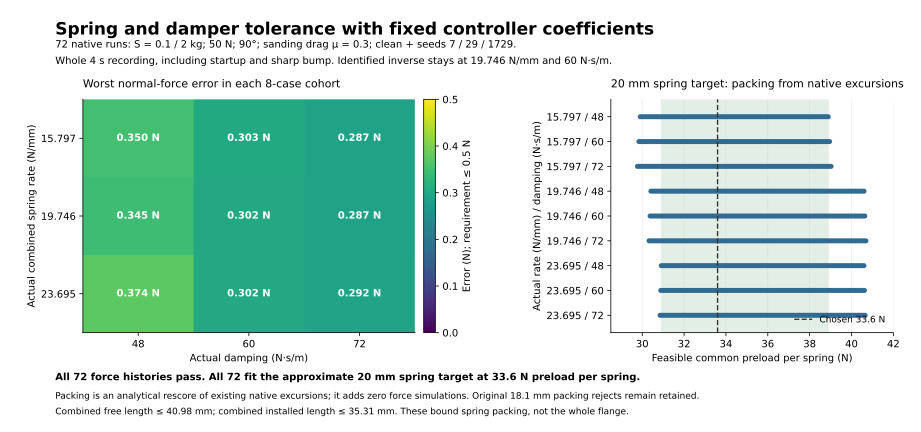

# V8 mechanical tolerance and spring packing

The goal is complete-recording normal pressing-force accuracy of ±0.5 N, including the 1 mm/10 mm sharp bump at 100 mm/s. This study evaluates actual spring/damper variation around the selected lower-series design while deliberately keeping its identified inverse model fixed.

All 72 native 4 s cases passed the force requirement. The worst normal-force error was **0.374370488 N**, with actual pair stiffness +20%, actual damping −20%, S=2 kg and noise seed 7. That leaves 0.125630 N of nominal force margin in this specific tolerance cohort. No case lost contact, reached a travel stop, exceeded current or clipped voltage. Maximum current and voltage across the cohort were 2.95840 A and 19.54996 V.

## Recorded contract

The frozen native input model is V8 SHA256 `73bbc46529f3c28d51d17766c4b0042d278446d29b5fdb21910f93c310937643`. Its actual acquisition uses 100 kHz raw sampling, a matched 5.1 kHz second-order anti-alias response plus 50 µs EMA, a 20 µs pipeline and fresh 10 kHz controller frames. Force/acceleration/position paths share the measured-motion frame. Conditioned targets are 0.02 N RMS per force axis, 0.014 m/s² acceleration RMS before the post-response ADC quantum of 0.00468 m/s², and 1 µm position RMS. The force-variation gate is enabled. These are engineering/model provisions, rather than measured prototype accuracy.

The current response is 100 µs. Force PI remains P=0.3 A/N, I=20 A/(N·s), D=0 with 1 kHz feedback-only rolloff and damping 1/√2. The proper lower-link inverse rolls off at 1.5 kHz. Its identified parameters stay at k=19.746 kN/m, c=60 N·s/m, B=0.6 kg and Kf=20 N/A. Every native result asserts that coefficient preparation preserved those identified values and the full numerator/denominator despite the actual mechanical change. S is a known/identified mass and is retuned to each tested tool.

The actual pair rate was 15.7968/19.746/23.6952 N/mm, actual damping 48/60/72 N·s/m. Each of the nine combinations has eight cases: S=0.1/2 kg, force 50 N, orientation 90°, μ=0.3, clean plus noisy seeds 7/29/1729. Clean disables random noise while retaining filtering, delays and quantization. Upper attachment stays rigid; intrinsic actuator friction remains. This finite cohort does not establish continuous robustness, different fixture modes or nonlinear real-damper behavior.

| Actual pair stiffness | Actual damping | Eight-case worst error | Original 18.1 mm packing | Approximate 20 mm packing |
|---:|---:|---:|---:|---:|
| 15.7968 N/mm | 48 N·s/m | 0.349618 N | 0/8 | 8/8 |
| 15.7968 N/mm | 60 N·s/m | 0.302951 N | 0/8 | 8/8 |
| 15.7968 N/mm | 72 N·s/m | 0.287257 N | 0/8 | 8/8 |
| 19.746 N/mm | 48 N·s/m | 0.345235 N | 8/8 | 8/8 |
| 19.746 N/mm | 60 N·s/m | 0.302383 N | 8/8 | 8/8 |
| 19.746 N/mm | 72 N·s/m | 0.287110 N | 8/8 | 8/8 |
| 23.6952 N/mm | 48 N·s/m | 0.374370 N | 8/8 | 8/8 |
| 23.6952 N/mm | 60 N·s/m | 0.301896 N | 8/8 | 8/8 |
| 23.6952 N/mm | 72 N·s/m | 0.291789 N | 8/8 | 8/8 |

[The figure manifest](inertial_mechanics_v8_tolerance_figure_manifest_20260930.json) binds the complete-recording cohort metrics and original excursion source. The shaded packing overlap is the feasible preload common to all 72 records; the dashed line is the actual 33.6 N setting.

## Approximate spring geometry

The original 18.1 mm free-length reference cannot accommodate the −20% actual-rate cases within its minimum working length at 50 N. Those 24 packing rejects remain in the original recorded result and retain their complete native histories. This is a physical spring-working-range rejection, while their force-control trajectories pass.

A **20 mm nominal free length per spring**, with the same ±0.49 mm allowance, 10.55 mm minimum working length, 0.5 mm working clearance, 0.25 mm unseating clearance and 68.543 N force envelope, satisfies all 72 recorded spring excursions at fixed 33.6 N preload. This is an approximate spring target, not a manufacturer claim or a renamed catalog part.

| Bound across all 72 original native records | Value |
|---|---:|
| Intersection of feasible common preload per spring | 30.910779–38.889731 N |
| Chosen common preload per spring | 33.6 N |
| Maximum combined free spring length | 40.980 mm |
| Maximum combined installed spring length | 35.307965 mm |
| Individual spring force range | 5.651121–61.548879 N |
| Individual compression range | 0.476984–7.790278 mm |
| Minimum installed individual spring length | 11.719722 mm |
| Largest required nominal free length with the selected preload | 19.330278 mm |
| Rigorous conservative upper bound on cyclic stroke | 1.088959 mm, below the 3.18 mm envelope |

The 20 mm geometry is an **analytical packing rescore of the existing native histories**: it runs zero additional force simulations and changes no force metric. Free length is not a coefficient of the linear force plant. Each of the 72 rows uses the exact compression offset originally computed from every native sample. All 24 retained packing-rejected raw traces were independently loaded and reproduce those offsets and original force errors. For the other rows, the complete-recording maximum absolute dynamic shift provides a conservative two-sided cyclic-stroke bound. The final saved model/parameter revision still requires the integrator's full native history identity proof after changing only spring metadata.

## Evidence and execution accounting

[The final 72-case native result](inertial_mechanics_lower_spring_actual_sensitivity_20260930_v8_pm20_acc_results.json) retains all force/packing failures, first/best/worst records, source/helper/candidate/recipe hashes and native full-recording balances. [The analytical rescore](inertial_mechanics_v8_20mm_geometry_rescore_20260930.json) binds the unchanged force histories, all 72 new packing rows and independently verified raw-trace hashes to that result.

[An independent changed-mechanics parity pair](inertial_mechanics_lower_spring_actual_parity_20260930_v8_pm20_results.json) proves Normal and Accelerator bitwise identical across all 72 channels and 400,001 native samples. The heavy tool, k−20%/c−20%, seed1729 force peak is 0.341861677 N in both modes. The main 72 Accelerator cases then finished in 194.4 s. [Four earlier ordinary cases](inertial_mechanics_lower_spring_actual_sensitivity_20260930_v8_pm20_results.json) were retained when the coordinator switched the workflow; they are separate repeated diagnostic executions and are not added to the 72 distinct design points.

The prototype mechanical target is therefore **approximately 20 N/mm combined pair stiffness, 20 mm free length per spring, 33.6 N preload per spring and 60 N·s/m parallel lower damping**, with a rigid upper attachment and all spring/damper support loads routed through the downstream multi-axis cell. Verify the actual springs' working range, force envelope and damper force–velocity curve. A real joining-frame/cell mode remains outside the massless series-cell approximation and needs physical identification.
