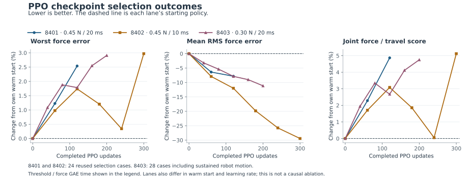

# PPO diagnostic result

The three completed PPO lanes kept their starting ES policy as the selected checkpoint. Training improved average force error, but no evaluated checkpoint improved the shared force/travel selection rank. This is evidence about these runs and their finite selection banks, not a general comparison of PPO and evolutionary search.

| Lane | Completed updates | Training decisions | Completed episodes | Last selection | Worst force error, start → last | Mean RMS force error, start → last | Joint score, start → last |
| --- | ---: | ---: | ---: | --- | --- | --- | --- |
| 8401 | 132 | 12,957,432 | 417 | Update 120; 24/24 pass | 0.440870 → 0.452063 N | 0.037318 → 0.034396 N | 0.999890 → 1.048569 |
| 8402 | 330 | 32,440,320 | 1,102 | Update 300; 24/24 pass | 0.440147 → 0.453225 N | 0.040006 → 0.028237 N | 0.996906 → 1.047967 |
| 8403 | 200 | 19,660,800 | 589 | Update 200; 28/28 pass | 0.418719 → 0.430897 N | 0.042499 → 0.037759 N | 0.933845 → 0.978216 |

All completed training episodes passed the force requirement; no physical contact/travel failures occurred. Partially active episodes remain in the retained final checkpoints and are not counted as completed episodes. All listed selection evaluations passed every force case and ended inside the allowed travel band. Initial or transient excursions beyond 7.5 mm remain soft costs.

The additional force-tail penalty used a 0.45 N threshold in 8401 and 8402. It activated in only one of 132 rollouts in 8401 and none of 330 in 8402. In 8403, lowering that threshold to 0.30 N activated the term in 70 of 200 rollouts. This change also increased the force-MSE reward scaling by 2.25×, and the run used a different ES warm start and the expanded sustained-motion bank. It is therefore not an isolated threshold ablation. Despite improving the individual peak errors of 21/28 selection cases, 8403 worsened the worst case by 2.91% and the combined selection score by 4.75%.

The optimizer remained stable. Median approximate KL over each final forty updates was 0.000090, 0.000507 and 0.000274 respectively; the critic used a detached shared representation. The policy weights and issued robot commands changed during training. The selection regression therefore cannot be described as an inactive trainer, a software rejection or a critic-gradient failure.

`results.json` preserves every selection point, paired per-case changes, source SHA-256 hashes, update totals and recent optimizer diagnostics. `analyze.py` regenerates the analysis and standalone SVG/PNG from the completed runs without simulating or accessing held-out cases. The adjacent `credit_diagnostics_v1` folder estimates the local measured-force response to randomized training-current perturbations; a 5 ms credit horizon was considered from that evidence but was not run.
