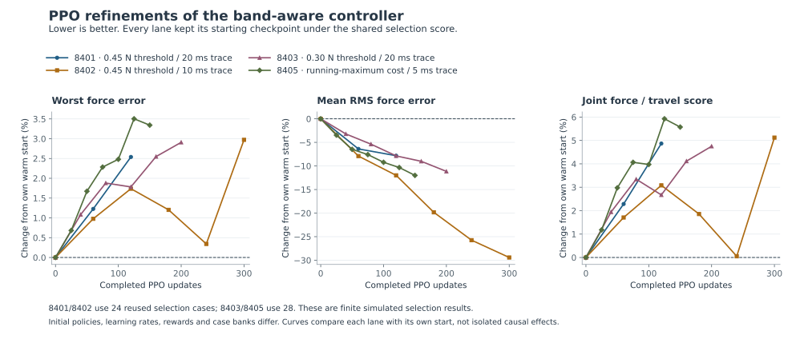

# Final PPO ledger

The root-owned PPO experiments completed **1,372 rollout updates and 15,824 optimizer minibatch steps**, using **124,368,632 native action decisions**. Another **98,304 decisions** were collected in the rejected inverse-initialized attempt and never used for a weight update. Three preparation rejections executed no decisions. Runner acceptance tests and ES searches are excluded.

| Run | PPO updates | Decisions used for updates | Completed episodes | Physical failures | Last evaluated selection |
| --- | ---: | ---: | ---: | ---: | --- |
| Legacy 8101 | 160 | 5,242,880 | 671 | 38 | 0/8 pass; 10.2788 N worst |
| Warm start 8301 | 200 | 19,660,800 | 960 | 0 | 14/16; 0.551756 N |
| Warm start 8302 | 200 | 19,660,800 | 960 | 0 | 14/16; 0.553659 N |
| Soft band 8401 | 132 | 12,957,432 | 417 | 0 | 24/24; 0.452063 N |
| Soft band 8402 | 330 | 32,440,320 | 1,102 | 0 | 24/24; 0.453225 N |
| 0.30 N tail penalty 8403 | 200 | 19,660,800 | 589 | 0 | 28/28; 0.430897 N |
| Running-peak objective 8405 | 150 | 14,745,600 | 431 | 0 | 28/28; 0.432714 N |

There were 5,130 completed training episodes, of which 4,344 met the force requirement. Partial episodes remain in final checkpoints and are not counted as completed. All 38 physical failures were in the early legacy run. The four completed band-aware runs had 2,539 completed episodes, all passing, but **each retained its own starting policy under the shared selection score**. Their last evaluated checkpoints reduced average RMS error while worsening the worst error and combined score.

The final running-peak run 8405 stopped cleanly at exactly 150 updates, after a 28/28 selection result. Its worst error rose from 0.418719 to 0.432714 N, RMS fell from 0.042499 to 0.037397 N, and the shared score rose from 0.933845 to 0.985882. The selected checkpoint remains update zero. Its final checkpoint agrees with the reported update, decision and episode counts.

Attempt 8404 is separate: its initial C-native evaluation passed 28/28 at 0.397905 N, but a numerical C-versus-Torch replay guard rejected the first 98,304-decision batch before any optimizer update. The guards were preserved; see the adjacent `inverse_replay_v1` diagnosis. Preparation attempts 8201–8203 failed while combining incompatible scenario metadata and executed no native decisions.

Earlier warm-start runs improved from 13/16 to 14/16 force passes, but did not qualify every selection case. Banks, initial policies, action scales and objectives changed across phases, so ranks are comparable within their recorded contracts. These are repeated finite selection tests, not held-out or hardware qualification.

`ledger.json` contains the audited counts, per-attempt configuration, selection points and exact source hashes. `build_ledger.py` reconstructs it from completed records and verifies checkpoint counts where the checkpoint contains collector state. The legacy checkpoint retains only optimizer state; its episode/decision totals are cross-checked between the final report and per-update records. `plot.py` generates the standalone SVG. No held-out outcome is read by either script.
