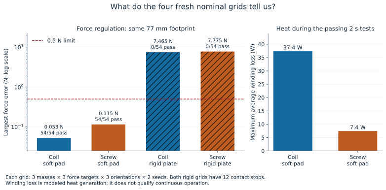
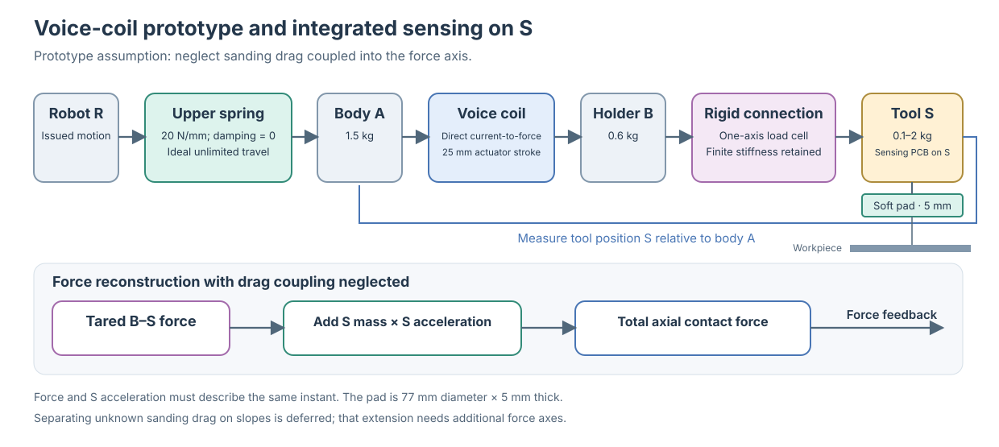
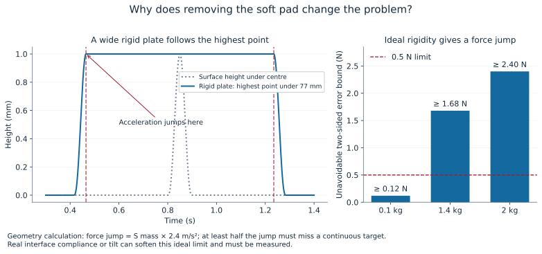
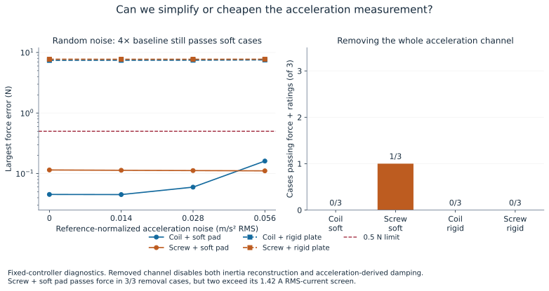
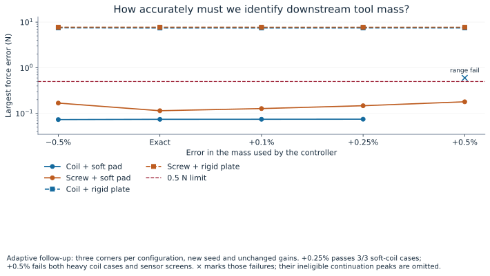
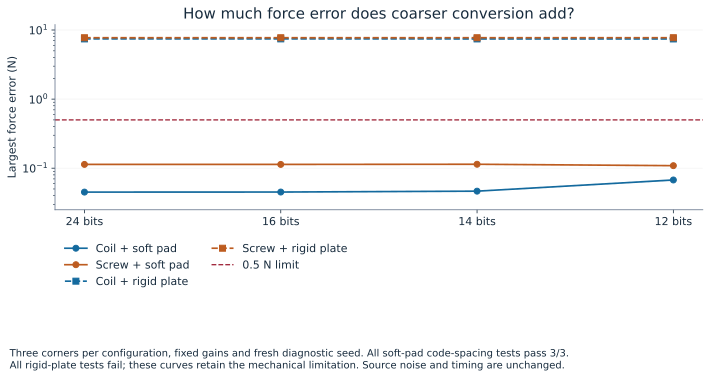
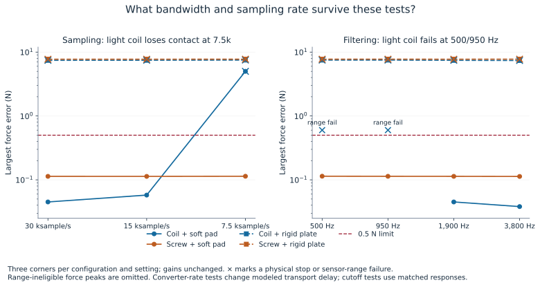
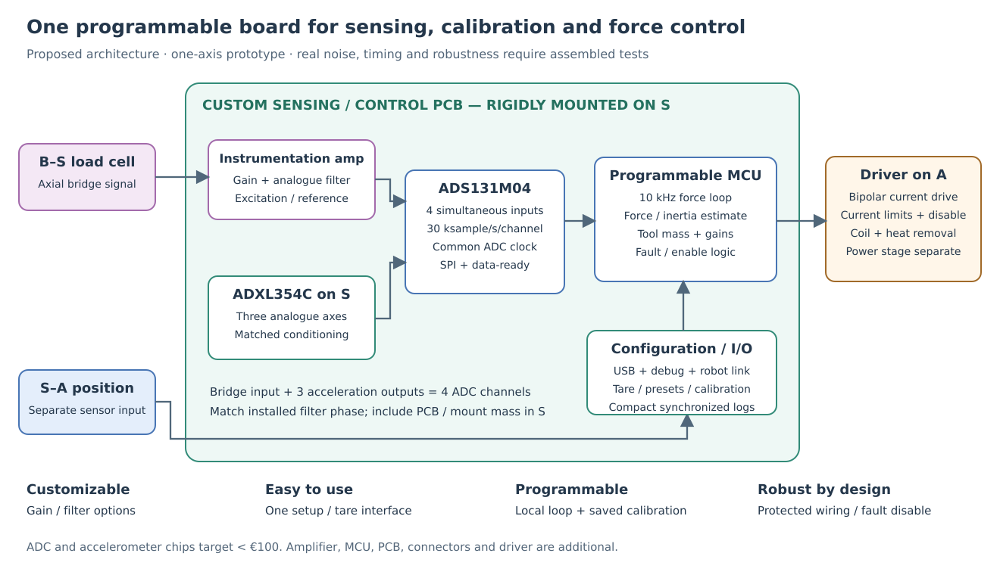

# Designing the active sanding flange

## Intro

Our goal is an active flange that keeps the **normal pressing force experienced by the workpiece within ±0.5 N**, including a **1 mm high, 10 mm wide bump crossed at 100 mm/s**. We want operation over **5–50 N**, tool masses **S = 0.1–2 kg**, and fixed flange orientations **0–90°**.

For the **first prototype**, we use a **one-axis B–S load cell and an accelerometer on S**, ignoring axial coupling from sanding drag. The current experiments therefore evaluate **total axial pressing force**. On slopes, separating normal pressing force from unknown drag remains an open problem requiring multi-axis force sensing. That extension is deferred.

The prescribed upper spring remains **20 N/mm, with zero damping and unlimited ideal travel**. The lower attachment is rigid, while the sensing cell retains its finite stiffness. **A** is the 1.5 kg actuator body/mount; **B** is the 0.6 kg moving holder; **S** is everything downstream of the cell, including the tool, sensing PCB and its mounting. Actuator travel is limited.

## Question

Which actuator, contact arrangement, controller and sensing electronics should we develop? Can a voice coil and custom PCB give accurate, understandable control at reasonable cost, and where do the present results leave design risk?

## Results

The newest model compares **four configurations with the same 77 mm footprint**. The soft interface is **5 mm thick**, with assumed **50 N/mm whole-pad stiffness and zero damping**. Without it, contact is an ideal **rigid 77 mm backing plate**, translating without tilt.

| Configuration | Passing nominal records | Largest force error | Contact stops |
|---|---:|---:|---:|
| Voice coil + soft pad | **54/54** | **0.053 N** | 0 |
| Spring-driven screw + soft pad | **54/54** | **0.115 N** | 0 |
| Voice coil + rigid plate | **0/54** | **7.465 N** | 12 |
| Spring-driven screw + rigid plate | **0/54** | **7.775 N** | 12 |

Each grid covers S = **0.1/1.4/2 kg**, targets **5/20/50 N**, orientations to gravity **0/45/90°**, and two fresh noise seeds. Controllers were locked before evaluation. The rigid controllers received their own bounded gain search; these are not simply the soft controllers reused unsuccessfully.

These are **two-second recordings starting at loaded equilibrium, with the robot fixed**. Every integration endpoint and rigid-contact event side counts, including startup. Force error above 0.5 N, contact loss or a travel stop fails a recording; sensor ranges and actuator ratings are additional screens. This demonstrates promising nominal soft-pad performance, **not complete sanding qualification**.

The current campaign contains **852 primary recordings**, including development and diagnostics. Fast sweeps use compiled physical equations; selected histories are checked independently against native Simulink blocks. Its [study guide and compact evidence](../acf_simulink/experiments/current_model_matrix_20261006/README.md) distinguish the fresh grids from tuning and sensitivity tests. Older report numbers are retained as historical evidence rather than used to assess this model.

### Mechanics and contact

#### Intro

The upper spring connects the robot to A. The actuator moves B relative to A. The cell joins B to S, and the pad supports S against the workpiece. Position measures **S relative to A**. There is no extra compliant lower suspension.

The physical equations integrate A/B/S motion and winding current, including gravity, springs, cell deformation and assumed guide friction of **0.2 N Coulomb plus 2 N·s/m viscous**. The screw adds independent nut and motor dynamics. Electrical saturation, actuator stroke and contact limits are checked as the motion develops.

#### Question

**How do soft pads influence our results?** Is the improvement merely averaging the bump, and what does a mechanical “mode” mean?

#### Results

A broad pad changes how contact develops, but the model does not replace the surface with an averaged height. The soft pad is divided into **61 weighted strips** across its circular footprint. Each strip compresses independently and carries no tensile contact force. Their forces are summed; S moves according to its own force balance. We assess **total force**, without making claims about local pressure or sanding quality.

The rigid plate instead follows the **highest point beneath its footprint**. This prevents geometric penetration without inventing pad softness. At the beginning and end of the flat top of its height envelope, acceleration changes abruptly by **2.4 m/s²**. Cell force remains continuous, so the surface force jumps by **S mass × 2.4 m/s²**.

Consequently, at least half that jump must miss a continuous force target: **0.12 N for S = 0.1 kg, 1.68 N for 1.4 kg, and 2.4 N for 2 kg**. No causal controller removes an instantaneous mechanical discontinuity. Both sides are scored explicitly. Real backing, workpiece compliance or tilt could soften the transition; the ideal rigid result is not proof that every real bare tool fails.

The example geometry resembles the [Mirka 77 mm × 5 mm interface](https://www.mirka.com/nl-nl/p/Interface-77---6-GRIP/?variant=94118). **50 N/mm and zero damping are our assumptions, not Mirka specifications.** At 50 N, flat compression is 1 mm. The model stops if compression exceeds its assumed **2.5 mm working allowance**. Real foam has nonlinear stiffness, hysteresis, temperature dependence and changing contact area.

A **mode** is a characteristic vibration pattern: which masses move relative to each other, and at what frequency. The calculated upper-body mode is about **18.4 Hz**. Tiny load-cell deformation creates a much faster B–S mode: about **1.64 kHz with rigid contact**, or **1.87–4.35 kHz with the soft pad**, depending on S. The assumed cell stiffness is **64 MN/m**; a 0.5 N force change corresponds to only **7.8 nm** deformation. “Rigidly mounted” does not mean vibration-free. These are linearized mechanical calculations, not measured resonances or closed-loop stability proofs.

#### Recommendation

Develop with the **77 mm × 5 mm soft interface**, while measuring its actual compression and frequency response. Keep the prescribed upper spring and rigid lower mounting. Identify cell/frame/guide modes before tuning; guide friction and foam response cannot safely be inferred from nominal dimensions alone.

### Actuator and electrical drive

#### Intro

The actuator must alter force quickly, provide sufficient travel, and sustain the load without excessive heat or moving mass.

#### Question

Why favour a voice coil over a leadscrew, and what parameters should the coil have? Would more voltage help?

#### Results

The coil makes force approximately proportional to current: **F = Kf × I**. The screw comparison is a proper **series-elastic actuator**: an independent nut compresses a **5 N/mm internal spring** against B. A nut encoder and motor servo control that deflection. This internal spring does not replace the prescribed upper spring or the rigid B–S connection.

The screw uses an **RE35-class motor, 10 mm lead, 75 g nut/carriage and 60 Hz nut servo**. Its rotor inertia loads the nut coordinate, rather than being added directly to S. It includes modeled shaft/guide friction, but not backlash, stiction or a holding brake. Both arrangements still require guidance and structural stiffness.

With the soft pad, the coil has lower nominal worst error: **0.053 versus 0.115 N**. It also gives a direct programmable force interface without an internal spring and nut servo. The screw has a substantial advantage in heat: maximum average winding losses are **7.4 W versus 37.4 W** for the coil. Its maximum RMS current is **1.07 A**, below the modeled 1.42 A continuous-current screen. Two seconds does not establish installed continuous thermal performance.

| Coil parameter | Prototype development target |
|---|---|
| Force constant | About **24.4–25 N/A**, characterized over the working stroke |
| Continuous hot force | **55–60 N**, with specified cooling and mounting |
| Peak force/current | About **85 N / 3.5 A**, with a defined pulse duty |
| Stroke | **25 mm**; retain the ±7.5 mm preferred working band |
| Winding | Reference **6.4 Ω cold, 8.896 Ω hot, 4 mH** |
| Mass allocation | Moving parts belong in B; stationary coil/body/mount belong in A |

Voltage demand includes **RI**, **L·dI/dt**, and motion-induced voltage. A steady 50 N hot-coil hold needs approximately **2.05 A and 37.4 W**. The stationary reference actuator body alone is around 1.24 kg, which explains the present A = 1.5 kg allowance.

Fresh three-corner drive pairs show that increasing usable voltage **32→48 V at unchanged 50 µs current response produces identical soft-pad results**. Neither actuator clips there; the nominal grids request at most **21.0 V coil / 26.5 V screw**. At 48 V with deliberately faster **25 µs** response, the coil diagnostic worst error improves **0.0450→0.0422 N**. Neither voltage nor faster response rescues the rigid plate. Current voltage headroom is therefore adequate for these cases; more voltage alone is not the main performance opportunity.

#### Recommendation

**Choose the voice coil for the first prototype**, prioritizing force tracking, direct control and mechanical simplicity. Accept its cooling requirement explicitly. Retain the spring-driven screw as the lower-heating alternative: the tests do not establish universal coil superiority, and calibration diagnostics below actually favour the screw's tolerance.

Use an adjustable **48 V-rated bipolar driver**, **3.5 A peak**, at least **32 V usable output**, and a measured **50 µs current-response target**. The current loop needs its own fast current measurement; the force ADC does not provide this guarantee.

### Controller

#### Intro

The controller receives acquired cell force, S acceleration and S–A position. The screw also receives its nut encoder. It has **no surface preview, known bump profile or future robot motion**.

#### Question

Which strategy works now, and what does “cell mode feedback” mean here?

#### Results

The selected soft-pad controllers use **proportional force feedback plus gravity holding feedforward and estimated-velocity damping**. Their force-integral gains are zero. The coil proportional gain is **10 N/N**, equivalent to **0.410 A/N** with Kf = 24.4 N/A; velocity correction is **200 N·s/m**. The screw uses **0.5 N/N**, or **0.1 mm/N** internal-spring deflection correction, plus **100 N·s/m** velocity correction.

Filtered acceleration is integrated with a **1 Hz leak**, producing an approximate velocity estimate while limiting drift. The coil uses an 80 Hz acceleration filter; the screw uses 100 Hz. The screw converts desired force into a nut-position target, filters it at 300 Hz, then uses the 60 Hz encoder servo. Position and speed errors determine current, so its force gain is not a single A/N number.

“Cell mode feedback” means deliberately targeting the vibration involving load-cell deformation, usually by shaping a measured signal near that frequency. The older reference used such an extra correction. **The current selected controllers do not use that historical correction.** The present velocity term is motion feedback, not evidence of robust suppression of every structural mode.

Loaded-equilibrium startup supplies nominal holding effort. Without a force integrator, persistent friction or sensor offsets can leave a steady error. The 18-family search per rigid actuator found no family passing every development corner; those selected branches remain failed comparison cases.

#### Recommendation

Start with the transparent deterministic soft-coil controller, then improve calibration and measured phase robustness. Do not substitute an older PI or learned policy and assume these results transfer. Engagement and steady offset rejection require new tests with the selected controller.

### Load cell and acceleration

#### Intro

The cell supports S, so its reading includes tool weight and inertia as well as surface reaction. Taring removes static gravity; it does not remove acceleration force.

#### Question

Can one load-cell axis and an accelerometer reconstruct pressing force? How accurate do the sensors and tool-mass estimate need to be?

#### Results

For the reduced axial model, **estimated contact force = tared cell force + identified S mass × measured S acceleration**. Only downstream S belongs in this correction. The acceleration must be kinematic acceleration with gravity handled consistently; a real accelerometer measures specific force and needs the corresponding compensation.

An acceleration error of **0.01 m/s² adds 0.02 N error at S = 2 kg**. S includes the board, bracket and other downstream attachments. The prototype therefore needs a measured tool profile, not just the nominal weight printed on the tool.

Removing the whole acceleration channel fails all three tested soft-coil corners. The soft screw passes force in all three but exceeds its RMS-current screen in both heavy cases. This removal disables **both inertia reconstruction and estimated-velocity damping**; it does not isolate reconstruction alone. All rigid-plate variants remain force failures.

The baseline assumes **0.02 N force noise, 0.014 m/s² acceleration noise and 1 µm position noise**, normalized at a fixed reference bandwidth. Force noise is bounded uniform; acceleration noise is Gaussian. Filtered baseline acceleration noise is about **0.0104 m/s² RMS**. These values exclude real spindle vibration and unmeasured temperature drift.

Increasing acceleration noise to **0.028 and 0.056 m/s²** retains all six soft-pad corner passes; worst error at the larger value is **0.161 N**. A **+0.02 m/s² acceleration bias** also passes, but raises screw worst error to **0.306 N**. Random-noise tolerance does not imply equal tolerance to bias, timing error or resonance.

The sharper limitation is calibration. A **+1% S-mass estimate fails both heavy coil cases**, including sensor ranges. A follow-up with a new seed finds **+0.25% passes 3/3 soft-coil corners**, while **+0.5% fails both heavy corners**. The soft screw passes all these mass follow-ups. Mass identification therefore matters to controller stability as well as static accuracy. Do not interpret large continuation peaks after sensor ineligibility as usable prototype predictions.

The follow-up also passes separate **±0.25% acceleration scale**, **±0.05% force scale**, and one combined signed mismatch. This is not a validated box of simultaneous errors. Identified mass affects controller inertia/gravity calculations while acquisition tare stays nominal; the experiment tests that combined dependency.

**Open problem: sanding drag.** Acceleration removes inertia, but cannot distinguish unknown normal force from tangential drag projected onto the sensing axis. That needs two force axes in a planar model or three for general spatial sanding. Soft-pad compression also prevents inferring surface slope from tool motion alone. We defer these problems without claiming normal-force reconstruction on arbitrary sanding surfaces.

#### Recommendation

Use roughly a **±100 N axial load cell**, with overload reserve and characterized finite stiffness. Start with calibration targets of **±0.01 N force zero**, **±0.05% force gain**, **±0.005 m/s² acceleration bias**, **±0.25% acceleration gain**, and **±0.1% identified S mass**. At 2 kg, that mass target is ±2 g. These are development targets supported by individual diagnostics, not joint accuracy guarantees.

Choose **ADXL354C on S** as the initial sensor. Its analogue outputs permit synchronized conversion. The datasheet's nominal 1.9 kHz bandwidth includes a **2.4 kHz mechanical resonance**, so our simple matched response is not its exact transfer function. Its ±8 g mode also has higher noise than ±2 g. Measure installed amplitude, phase and temperature behaviour before relying on cancellation. [Manufacturer datasheet](https://www.analog.com/media/en/technical-documentation/data-sheets/adxl354_adxl355.pdf).

### Amplifier, ADC and acquisition timing

#### Intro

An ADC converts analogue sensor voltages into numbers. The instrumentation amplifier strengthens the bridge output and provides a chosen analogue cutoff. **Resolution** is code spacing; **sampling rate** is fresh readings per second; **bandwidth** describes changes the chain follows. None alone establishes accuracy.

#### Question

Is a separate ADC necessary, what performance is sufficient, and what is the cheapest sensible route?

#### Results

Analogue force and acceleration require conversion somewhere. A separate ADC chip is optional if a microcontroller's ADC has adequate noise, settling and synchronization.

The current model uses **30 ksample/s per channel**, **10 kHz controller updates**, matched two-pole **1.9 kHz responses**, approximately **49.6 µs converter delay**, **50 µs smoothing at the ADC output rate**, and a **20 µs pipeline**. This is a simplified response/delay model, not an exact ADS131M04 filter or measured amplifier chain.

| Fixed-controller diagnostic | Soft coil, worst error | Soft screw, worst error |
|---|---:|---:|
| 24-bit codes, 30 ksample/s | 3/3; 0.045 N | 3/3; 0.113 N |
| 16-bit codes, 30 ksample/s | 3/3; 0.045 N | 3/3; 0.113 N |
| 12-bit codes, 30 ksample/s | 3/3; 0.067 N | 3/3; 0.109 N |
| 24-bit codes, 15 ksample/s | 3/3; 0.058 N | 3/3; 0.113 N |
| 24-bit codes, 7.5 ksample/s | 2/3; one contact stop | 3/3; 0.114 N |

Bit tests retain source noise and timing. The small screw improvement at 12 bits is a noise/quantization coincidence, not evidence that fewer bits improve hardware. With ±160 N electrical force scaling, code steps are **0.00488 N at 16 bits** and **0.0781 N at 12 bits**. Acceleration steps are **0.00359 and 0.0575 m/s²**, respectively. Amplifier gain and reference quality remain important.

Rate tests increase converter delay as sampling slows. Separately, matched **500/950 Hz bandwidth** loses contact in the light coil case; **1.9/3.8 kHz** passes the soft corners. The experiments, together with the cell-mode frequencies, support keeping adequate bandwidth and low delay. They do not establish a universal minimum: different controller tuning could change the boundary. All corresponding rigid-plate diagnostics fail force because improved acquisition does not remove their contact limitation.

| ADC route | Recorded chip cost including VAT | Practical interpretation |
|---|---:|---|
| MCU's existing ADC | €0 additional chip | Cheapest possibility; real noise, skew and filtering unproven |
| MCP3208, 12-bit multiplexed | €2.95 | Promising code spacing; sequential timing needs separate validation |
| ADS131M02, two simultaneous channels | €4.79 | One axial force plus one aligned acceleration axis |
| **ADS131M04, four simultaneous channels** | **€7.15** | One force plus all three acceleration outputs |

*Quantity-one observations from 5–6 October 2026, not current quotations; shipping and other electronics excluded. [Reviewed sources and prices](../acf_simulink/experiments/report_readability_20261006/adc/README.md).*

MCP3208's **100 ksample/s is aggregate**, at most 25 ksample/s each for four sequential channels. Combining reduced bits, slower sampling and channel skew has not been tested here. The [M02](https://www.ti.com/product/ADS131M02) and [M04](https://www.ti.com/product/ADS131M04) provide simultaneous sampling. The M04's extra two channels cost about €2.36 over M02 and help characterize gravity alignment and off-axis vibration.

#### Recommendation

Use **ADS131M04 at 30 ksample/s**, with matched installed force/acceleration response around the tested **1.9 kHz** envelope. ADXL354C plus M04 total approximately **€81.82** at the recorded prices, below the €100 chip budget. Cheaper ADCs and accelerometers remain plausible: these tests reveal noise/code margin, but do not identify a qualified cheapest hardware chain. Test measured transfer functions and channel skew before cutting cost further.

### Integrated PCB and robot interface

#### Intro

A custom board on S can combine bridge amplification, filtering, acceleration, acquisition and local control. The hot power driver stays on A, physically separated from low-level sensing.

#### Question

Why integrate the electronics, and how should local control interact with robot recentering?

#### Results

| Design objective | What the board provides |
|---|---|
| Customizability | Configurable amplifier/filter settings, sensor calibration and controller gains |
| Ease of use | One tool profile, connector scheme and calibration interface |
| Programming | MCU firmware with timestamped logging, USB/debug access and selectable control strategies |
| Robustness | Short differential bridge paths, shared acquisition timing, protected connectors and defined driver-disable behaviour |

Integration creates a controlled platform for testing these properties; it does not make them proven. Buffer the accelerometer appropriately, manage supply/reference drift, and keep switching-current return paths away from bridge inputs. Store identified S mass, sensor scales, zeros and timing with each tool configuration. Provide an independent watchdog and stop path.

S–A position needs a separate digital or separately acquired input; all four M04 channels are allocated. The modeled **1 µm RMS position noise** is a starting assumption whose allowable degradation has not been swept in this campaign.

The fast force loop runs locally at 10 kHz. Robot commands should recenter slowly when force is stable, with hysteresis and dwell to avoid repeatedly opening and closing the gate. Already-issued commands continue through robot delay after the gate closes, so the predictor must track that queue. Staying within **±7.5 mm** has no centering penalty; the **±12.5 mm hard stroke limits** still apply.

**The newest four-way tests hold the robot fixed.** They do not validate the gate, queued commands, engagement, long-term drift or recentering. Old robot-controller results cannot be transferred automatically to this soft-pad controller.

#### Recommendation

Build the custom sensing/control PCB and separate bipolar driver. Then test calibration/phase robustness, pad response, engagement, sustained recentering, powered-spindle vibration and continuous heating. Native Simulink replays already reproduce the four selected physical histories, including the rigid failures, and finer rigid steps preserve their outcomes; this is plant verification with recorded commands, not a promoted closed-loop desktop model or physical prototype validation.

## Recommendation

**Develop a voice-coil flange with the 77 mm × 5 mm soft interface and a custom integrated sensing/control PCB.** Use a characterized **approximately 25 N/A, 25 mm-stroke coil**, a **3.5 A bipolar driver with at least 32 V usable output**, an axial B–S load cell, **ADXL354C on S**, **ADS131M04**, and local deterministic control. Preserve the required upper spring and rigid lower attachment.

This gives the best nominal force tracking of the tested practical candidates and a flexible platform for programming and measurement. Budget for approximately **37 W worst modeled winding heat**, and resolve the demonstrated **mass/phase sensitivity before calling the controller robust**. The spring-driven screw remains the credible cooler, more calibration-tolerant alternative. The soft pad is essential to the present successful model; its properties, electronics timing and assembled behaviour must be measured before claiming the complete sanding requirement.
