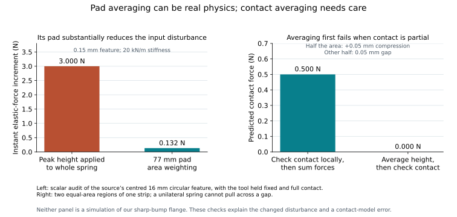
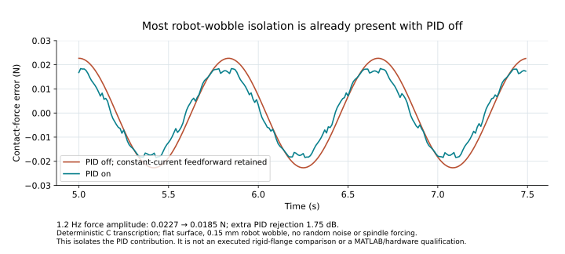

# Critical review of the group member’s polishing model

**6 October 2026 · Code inspection, catalogue checks and seven small deterministic experiments**

## Goal and verdict

Our question is whether a flange can maintain the workpiece’s pressing force within **±0.5 N**, including a **1 mm high, 10 mm wide bump at 100 mm/s**, across 5–50 N and the specified tool masses and orientations. The prescribed upper spring is 20 N/mm with zero damping; the lower connection is rigid apart from the load cell’s finite stiffness. The first prototype uses a B–S load cell and an accelerometer on S, with drag reconstruction deferred.

**Our model is the stronger basis for that design question. The supplied script is a useful demonstration of a different, easier polishing system, but its results do not qualify our flange.** Its most useful addition is a compliant sanding pad with a finite footprint, which our present model lacks. That deserves a properly calibrated implementation and a separate comparison.

This review concerns the supplied [MATLAB file](/home/tommie/.t3/userdata/attachments/01841b08-301d-4777-adff-31fadb25efcb-88b1025a-6ce3-4001-9d13-cf2dc04258b1-txt.txt). I inspected the equations and ran a deterministic C transcription of their update sequence, with Gaussian noise disabled. **These were not native MATLAB replays or hardware qualification runs.** The original script, our models and the main report were preserved.

## Does the broad pad make the comparison unfair?

A real broad pad distributes load. Under full contact, a linear elastic pad’s total force can legitimately depend on area-weighted surface height. That is a physical design benefit. It becomes an unfair controller comparison when the pad, bump geometry and speed change together and the resulting small error is presented as solving our original test.

The executing code uses a **77 mm pad** and, by default, a **0.15 mm high circular island of 16 mm diameter at 50 mm/s**. Our test is larger and faster; its specified longitudinal width does not establish a circular footprint. Even the script’s stress preset uses a different bump: 0.7 mm high and 28 mm in diameter.

Using its own 35-strip geometry, the default island raises the pad’s mean surface height by just **6.60 µm**. With its 20 kN/m pad stiffness and the tool held fixed, that adds **0.132 N** of elastic force. Applying the full 0.15 mm height to the whole lumped spring would add 3 N. This arithmetic isolates the geometry effect; neither value is a closed-loop simulation of our sharp-bump flange.

There is also a contact-model defect. Lines 697–704 average the island’s height across each strip **before** checking whether contact exists. With half a strip compressed by 0.05 mm and the other half separated by a 0.05 mm gap, averaging first predicts zero force. Checking local contact first and then integrating predicts **0.5 N** at 20 kN/m. Averaging works for the elastic term while all those locations remain in contact; this counterexample demonstrates why it fails with partial contact, rather than an observed failure of the default run.

The damping term is simply `d_pad * vy` (line 709). It omits the changing surface height’s contribution to compression velocity and the active contact area. Calling this an “exact 2D Winkler” model overstates the implementation. Finally, controlling total force does not guarantee uniform local pressure or uniform sanding removal: a raised island can carry disproportionately high pressure.

**Recommendation:** borrow finite-pad contact, but integrate local compression and compression velocity before summing forces. Use the same physical pad and surface geometry for competing controllers, and inspect pressure as well as total force.

## Does it measure the force that our load cell would measure?

**No.** Lines 714–724 feed the calculated contact force `Fc` directly into the alleged load cell, then add errors and filtering. This represents a sensor measuring contact force directly. It does not represent our cell mounted above the tool, between B and S.

For that location, the measurement includes the downstream tool’s dynamic inertia. Taring removes static weight, not acceleration. For its 1.1 kg tool, only **0.455 m/s²** produces a 0.5 N inertial contribution.

The deterministic fine- and coarse-sanding cases produced peak tool accelerations of **0.603 and 1.470 m/s²**. Multiplying by 1.1 kg gives omitted inertia-term magnitudes of **0.663 and 1.617 N**, respectively. These magnitudes show that the omission matters; they are not simulations of a corrected sensing chain. That requires a specified load-cell location, where the vibration forces act, and synchronized acceleration acquisition.

The error model also needs clearer provenance. Its nonlinear term is +0.075 N at 25 N and +0.100 N at 50 N. Corresponding deterministic mean contact errors were approximately −0.075 and −0.100 N: integral control corrects measured error, including the biased reading. The velocity-dependent term labelled “hysteresis” has no load-history memory. Unseeded Gaussian noise prevents exact reproduction.

**Recommendation:** retain our physical sensing location and inertia reconstruction. The one-axis choice is acceptable within the agreed drag-free prototype scope; direct access to contact-force truth is the consequential simplification here.

## Can the named motor and driver produce the simulated motion?

The motor itself is real, and its main catalogue numbers largely match: 25.6 N/A, 5.7 Ω, 8.15 mH, 46.1 N continuous and 202.3 N peak. However, naming a part does not enforce its operating limits. The script declares inductance and continuous force but does not use them in the dynamics. [Akribis catalogue](https://akribis-sys.oss-cn-shanghai.aliyuncs.com/uploads/upload/files/20250831/4a3605602de3c1cb6f2a38a76d3884c2.pdf)

Line 746 models current as a first-order response with a fixed 40 µs time constant, independent of supply voltage, inductance, resistance and back EMF. The EPOS4 Micro 24/5 has a **25 kHz current-control clock**; a 40 µs clock interval does not establish a 40 µs current-response time constant. Its maximum output is 90% of supply, or **21.6 V at 24 V**. [Maxon hardware reference, pp. 10 and 54](https://www.maxongroup.com/medias/sys_master/root/8994700853278/EPOS4-Micro-24-5-CAN-Hardware-Reference-En.pdf)

Its allowed 202.3 N command requires 7.90 A and **45.0 V just for cold winding resistance**, before inductive voltage or back EMF. The named 24 V drive therefore cannot deliver that peak envelope. This does not mean every low-effort default trajectory exceeds its voltage: voltage clipping must be evaluated on the actual waveform.

Continuous operation is also unchecked. At 50 N with a horizontal axis, static current is **1.953 A**, above the motor’s 1.8 A continuous rating. The display’s cold `I²R` value does not establish hot-coil thermal feasibility; there is no temperature state or continuous-current failure criterion.

The ADC claim is similarly unsupported. `50/4096` gives 0.0122 N per code, despite a declared 100 N sensor. At 100 N mapped onto 0–10 V, the EPOS input’s specified 5.64 mV increment corresponds to **0.0564 N per code**. It refreshes at **2.5 ksample/s**, separate from the 25 kHz current loop. A different gain mapping could change force resolution, but must also provide the necessary range. The script never clips ADC codes; our horizontal 50 N check generated 12,639 latched codes outside 0–4095. These are chain-definition defects, not evidence that 12 bits can never meet ±0.5 N.

**Recommendation:** borrow catalogue parameters, then enforce electrical, thermal and acquisition limits. Do not copy the ideal current response or use this script to justify ADC selection.

## What does the claimed 43 dB rejection demonstrate?

The header claims robot-wobble rejection of 43 dB, but the script does not simulate a rigid baseline or calculate that rejection. Switching PID off retains constant-current force/gravity feedforward. A free-moving force actuator can already isolate slow robot motion mechanically.

On a flat surface, without random noise or spindle forcing, the 1.2 Hz contact-force amplitude was **0.02270 N with PID off and 0.01855 N with PID on**. That is **1.75 dB of additional rejection from PID**. It does not measure total isolation against a rigid flange, so it neither establishes nor categorically disproves 43 dB against that other baseline.

The assumed 0.15 mm, 1.2 Hz robot sine is not established by a positional accuracy specification. Real amplitude and spectrum depend on the path, posture and motion. The vibration amplitudes assigned to sanding presets also need measurements.

The PID itself is causal and has legitimate force/gravity feedforward. Its integrator clamp provides limited windup protection, and its derivative is unfiltered. None of this proves the controller is intrinsically bad; it simply has not been tested on our plant.

## Which model should lead the project?

| Issue | Supplied script | Our current fixed-mechanics model |
|---|---|---|
| Mechanics | One moving mass; pad and guide losses | Prescribed upper spring, A/B/S dynamics and finite cell stiffness |
| Sensing | Contact-force truth plus errors | Physical cell measurement and measured-inertia reconstruction |
| Drive | Ideal current lag and peak force clamp | Winding dynamics, back EMF, voltage/current clipping |
| Sanding contact | Simplified finite compliant footprint | No finite compliant pad or pressure distribution |
| Robot | Prescribed slow sine | Delayed, stability-gated recentering and issued-command observer inputs |
| Evidence | Interactive cases; startup excluded | Locked cohorts, fresh seeds, full-history scoring and failure stops |

The script’s 3D presentation accompanies **one-dimensional dynamics**, not a spatial mechanical simulation. Its rendered Gaussian bump, finite-depth hole and pit also differ from the solver’s circular island, removed contact area and omitted pit. Orientation changes gravity; it does not solve general spatial sanding. Our model also simplifies spatial contact, and neither model proves real sanding performance.

The numerical method is not the main problem. Exact exponential updates for its first-order filters are sensible. Halving the mechanical step from 100 to 50 µs changed one deterministic polishing peak by only **0.000025 N**. That supports this one smooth case, not every preset. The original also mixes pre-update force and post-update motion timestamps.

Its acceptance metric excludes the first 0.2 s, and contact loss or stroke-limit violations do not stop and invalidate the simulation. No automatic full-range qualification is provided. Our current model has stronger checks, but **still fails the full requirement**: the locked reference results are 683/700 nominal, 21/32 stress and 1/4 long passes, with worst errors of 0.580, 3.948 and 0.691 N. These reference tests used their frozen multi-axis sensing assumptions; they do not qualify the proposed one-axis prototype. [Recorded results](/home/tommie/Projects/actuator-model/acf_simulink/validation/upper_no_damping_20261005/report/fixed_qualification_results.json)

**Concrete recommendation:** keep our native Simulink mechanics, sensing and drive as the project’s foundation. Add a separately versioned, calibrated finite-pad contact model and measured spindle/robot disturbances. Borrow the clear replay, force overlays and component telemetry. Compare controllers on identical inputs, include startup and physical failures, and retain PID as a simple baseline. Do not replace our model with this script or treat its small force errors as proof of a practical design.

## Inspectable evidence

The [compact checks](/home/tommie/Projects/actuator-model/acf_simulink/validation/member_script_review_20261006/review_checks.json), [seven case metrics](/home/tommie/Projects/actuator-model/acf_simulink/validation/member_script_review_20261006/deterministic_checks.json) and [reproduction recipe](/home/tommie/Projects/actuator-model/acf_simulink/experiments/member_script_review_20261006/README.md) distinguish code inspection, arithmetic counterexamples and executed deterministic transcriptions. Gaussian noise was disabled; no native MATLAB replay, corrected-sensor test or new model qualification was performed. Only two downsampled robot traces were saved.

Source SHA256: `332aa45edd7fd97fb3f596180e3209b49640250d4072825a1405af92d0b9675f`.
